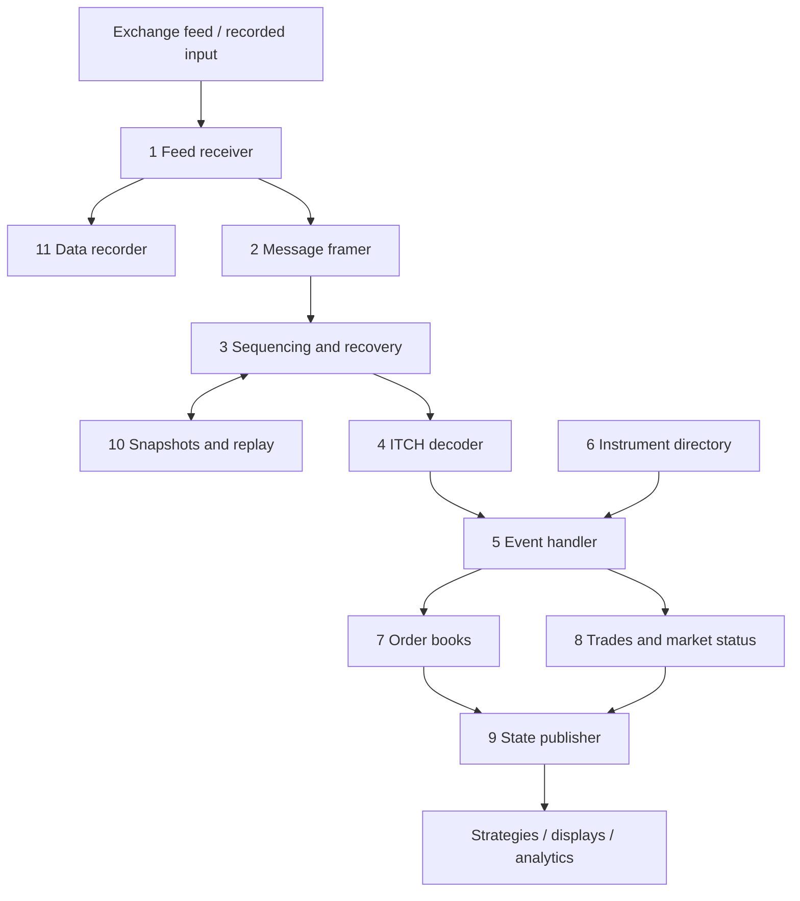

# 001 — Scope and plan

**Status:** Measured · **Updated:** 2026-10-28

## Proposal

A feed handler for Nasdaq TotalView-ITCH 5.0, written from the public specification. It receives
the exchange's market data, rebuilds the order book the exchange publishes, and makes that state
available to other programs, always marked as current or not. The exchange does the matching;
this handler observes and reconstructs the results it publishes.

It is meant to be judged on four things:

1. **Correct books, shown.** Replaying a full recorded trading day, the books match an
   independent reference implementation after every message, and their invariants hold
   throughout. There is no official "expected book" to compare against, so the reference is
   built here, deliberately simple, and published with the handler.
2. **Recovery under loss.** Packets are dropped, duplicated and reordered on purpose. The handler
   detects each gap, recovers by retransmission or from a snapshot, marks what it publishes as
   unreliable while it does, and comes back equal to the reference.
3. **Measured like `lockfree-ipc` and the gateway.** Latency from packet to published update as
   percentiles, open loop, and throughput over a whole day, with the machine's conditions in
   every run, beside the reference implementation on the same harness.
4. **Alternatives, measured.** Each major choice is built more than one way and measured: how
   orders are found by their reference number, how price levels are kept, how the work is
   arranged on threads.

**Where the risk is.** The costly failure is not slowness but a wrong book that looks right: a
missed message leaves an order on the book that is gone at the exchange, and every later update
to its price level is wrong with it. So gap detection, the reliability flag and recovery are the
centre of the design, and each is a test that injects the loss.

It does:

- the TotalView-ITCH 5.0 messages, every type, decoded; the order book from Add, Execute, Cancel,
  Delete and Replace, per instrument, by order and by price level;
- trades (including non-displayed and cross trades), trading status, halts and auction
  information (the Net Order Imbalance Indicator), kept apart from the displayed book;
- MoldUDP64 over UDP multicast, with gap detection and re-requests, and a re-request server of
  our own to recover from; recorded files read through the same path;
- snapshots of the book state for a faster start and for recovery after a large loss;
- publication to other programs through `lockfree-ipc`'s rings, with each update's sequence
  number and reliability state;
- recording of the input, and counters and health states for monitoring.

It does not:

- send orders, run strategies or keep positions: observation is kept apart from execution. That
  is the integration repo's (ITCH in, queue, pre-trade risk, FIX out);
- handle other feeds now: the London Stock Exchange's specifications are published (Level 2-MITCH,
  MIT303, and the Group Ticker Plant that improves on it, GTP 001 and 002), but its data is
  licensed, with no public sample, so results on it could not be reproduced; the book is written
  so a second feed could be added behind it later;
- use kernel bypass or FPGAs: dev-lnx01 has neither. The kernel UDP path is measured and its
  floor stated;
- connect to Nasdaq: we have no feed. The live path runs against our own MoldUDP64 sender
  replaying recorded days, over loopback and over the machine's 10GBASE-T ports.

## Design

**Sources**, all public and free:

- *Nasdaq TotalView-ITCH 5.0* specification, nasdaqtrader.com, last revised 28 April 2023;
- *MoldUDP64 Protocol Specification* V1.00, nasdaqtrader.com;
- *SoupBinTCP* 3.00, nasdaqtrader.com, the TCP transport GLIMPSE runs over;
- *Nasdaq GLIMPSE 5.0*, nasdaqtrader.com, last revised 22 August 2024: the snapshot service;
- Nasdaq's sample data: eight full trading days in TotalView-ITCH 5.0 at
  `emi.nasdaq.com/ITCH/Nasdaq ITCH/` (one is 30 January 2020, 5.6 GB compressed). They're fetched
  by a script into the ignored `data/`, their SHA-256 recorded and checked, and never committed.

**Snapshots, as Nasdaq offers them.** GLIMPSE sends, over SoupBinTCP, the day's directory and
trading-status messages and an Add Order for every displayed order resting at the time, all in
TotalView-ITCH's own formats, then an End of Snapshot message giving the ITCH sequence number to
resume the live feed from. We cannot connect to Nasdaq's, so the snapshot server is our own,
speaking GLIMPSE 5.0, built from the recorded day (D4).

**What the feed gives, and what it doesn't.** ITCH is order by order. Every message carries the
instrument's Stock Locate code (a small integer, assigned each day by the Stock Directory message,
meant as an array index). An Add Order gives the order's reference number, side, shares and
price. Executions, cancels and deletes give only the reference number and the shares, so the side
and price come from the order as it was added. Replace gives a new reference number, shares and
price, keeping the old side. So the hot structure is the table from reference number to order,
looked up on nearly every message, more than the price levels.

**The components** (from Shep's overview):

| # | Component | Purpose |
|---|---|---|
| 1 | Feed receiver | Receives the multicast data, or reads recorded data, through one path. Owns the sockets and buffers |
| 2 | Message framer | Splits MoldUDP64 packets into messages and checks their boundaries |
| 3 | Sequencing and recovery | Keeps messages in order, drops duplicates, detects gaps, recovers before the book is called reliable again |
| 4 | ITCH decoder | Turns binary messages into events: an order added, executed, cancelled; a status change |
| 5 | Event handler | Routes each event to the state it changes: books, trades, status |
| 6 | Instrument directory | Maps Stock Locate codes to instruments and their books |
| 7 | Order book | Displayed orders, price levels, quantities, best bid and offer, per instrument |
| 8 | Trades and market status | Trades, auctions (imbalance), halts and closures, kept apart from the displayed book |
| 9 | State publisher | Gives consumers a consistent view, with whether it is current |
| 10 | Snapshots and replay | A starting state, recovery after a large loss, rebuilding from recordings. A book snapshot does not restore missed trade history |
| 11 | Data recorder | Saves what was received, and whether the capture is complete |
| 12 | Configuration and monitoring | Feeds, instruments and limits; connection health, gaps, delays and failures |

Configuration and monitoring (12) serve every component.

**Principles** (from Shep's overview, kept):

- *Keep the main path small:* no slow work while applying book updates.
- *Give state one owner:* one thread owns the state of an ordered feed to begin with; these
  components are not threads or services each. Whether a second thread helps (receiving apart
  from applying) is measured, not assumed.
- *Separate observation from execution:* consumers may act on the output; order entry and
  positions belong elsewhere.
- *Make reliability visible:* incomplete or stale data is marked as such to every consumer.
- *Build for replay:* recorded and live input go through the same decoding and state code.

**Sans-I/O core, as in the gateway.** The decoder, sequencing, event handler and books are pure:
messages in, state changes and events out, no sockets, clocks or threads inside. Then a recorded
day is a deterministic test, and the core can be measured apart from the kernel.

**The reference implementation.** A second book, written for clarity rather than speed (standard
maps, no tricks), fed the same events. It is both the correctness oracle and the baseline the
fast book is measured against. No external ITCH handler is taken as a baseline here: none is a
standard the way QuickFIX is for FIX. One may be added later, after its licence is read.

**Reuse of `lockfree-ipc`.** Its rings and its measurement harness (clock, histogram, open-loop
generator, environment, noise floor, `run.py` report), fetched by CMake at a pinned commit into
`build/`, as the gateway does.

**Decisions** (each with what is proposed):

- **D1. Live transport.** *Proposed:* MoldUDP64 over UDP multicast, with re-requests to a
  re-request server, as Nasdaq offers it; our own sender replays recorded days at chosen rates.
  *Alternative:* SoupBinTCP (TCP, no loss to recover from), left out: it would skip the hard
  part.
- **D2. Test data.** *Proposed:* Nasdaq's sample day of 30 January 2020 for the full-day replay
  and the published figures, the other days as checks; small hand-built files for unit tests and
  CI (CI cannot download 5.6 GB).
- **D3. Correctness.** *Proposed:* the reference implementation compared after every message on
  the best bid and offer and the changed level, and in full depth at checkpoints; invariants
  throughout (no negative quantity; no order executed or cancelled beyond its shares; a crossed
  book only where the exchange's own state allows it, which the order book note sets out).
- **D4. Snapshot format.** *Proposed:* GLIMPSE 5.0 over SoupBinTCP, served by our own snapshot
  server: a public protocol, and the books rebuilt from it by the same decoder and book code as
  the live feed. A snapshot restores the books, not missed trades, and says so. *Alternative:* a
  format of our own (the book state and the sequence number): simpler, but nothing anyone else
  speaks.

**Component notes, in order** (Shep's discussion order; each a Draft for agreement before code):

| Note | Component | The hard part |
|---|---|---|
| 002 | Order book (7) | The reference-number table and the price levels, each built more than one way and measured; the reference implementation; the invariants |
| 003 | Event handler, instrument directory, trades and status (5, 6, 8) | Routing without slow work; Stock Locate as an index; what each status message changes; non-displayed and cross trades kept apart |
| 004 | ITCH decoder (4) | Every message type of 5.0, big-endian fields, 6-byte timestamps, no allocation; an unknown type skipped and counted |
| 005 | Sequencing and recovery (3) | Gaps, duplicates and reordering in MoldUDP64; re-requests; the reliability state; injected loss as tests |
| 006 | Snapshots and replay (10) | A snapshot consistent with a sequence number; restoring and catching up; what cannot be restored |
| 007 | Receiver and framer (1, 2) | Multicast sockets, receive buffers and drops, busy polling; the recorded file through the same path; MoldUDP64 framing |
| 008 | Publication (9) | A consistent view for consumers on other threads or processes, through `lockfree-ipc`; the reliability state with every update |
| 009 | Recording and monitoring (11, 12) | Recording without slowing the main path; counters and health states |
| 010 | Measurement | Packet to published update, open loop, and full-day throughput, beside the reference implementation |

## Spec

The repo as a whole, checked as the notes reach Measured:

- S1. Replaying Nasdaq's sample day of 30 January 2020, every book equals the reference
  implementation's after every message (best bid and offer and the changed level) and in full
  depth at checkpoints; the invariants hold throughout.
- S2. Every TotalView-ITCH 5.0 message type is decoded and tested field by field against the
  specification's layouts; an unknown type is skipped and counted, never fatal.
- S3. With packets dropped, duplicated and reordered on purpose, every gap is detected and
  recovered by re-request or snapshot; while it lasts, what is published is marked unreliable;
  afterwards the books equal the reference's again.
- S4. The decoder, book and publication hot paths make no allocation or system call (checked in
  the compiled code, as in the gateway).
- S5. Latency is published as percentiles over at least three runs and full-day throughput as
  messages a second, via `run.py report`, beside the reference implementation on the same harness.
- S6. Each measured alternative (reference-number table, price levels, threads) is published beside
  the others; the chosen one is justified from them in its note.
- S7. Live and recorded input give the same result: a run received over multicast and recorded,
  replayed from the recording, produces the same books and the same published updates.

## Tasks

- [x] Shep: empty GitHub repo `Mukachi/itch-feed-handler` (private)
- [x] Read the terms of Nasdaq's sample data; record what they allow here (Review, 2026-10-25)
- [x] Notes 002–010, one at a time, each agreed before its code

## Review

| Date | Stage | Finding |
|---|---|---|
| 2026-10-25 | Draft | Written for review from Shep's overview of the engine (its twelve components, principles and discussion order kept; one line referring to an unrelated system left out, as Shep asked). Checked today: the TotalView-ITCH 5.0 specification (36 pages, last revised 28 April 2023), MoldUDP64 V1.00 and SoupBinTCP 3.00 download from nasdaqtrader.com; the GLIMPSE 5.0 link redirects to a not-found page; eight full sample days are listed at `emi.nasdaq.com/ITCH/Nasdaq ITCH/`, 30 January 2020's 5.6 GB compressed. Decided with Shep before drafting: Nasdaq TotalView-ITCH 5.0 (over LSE MITCH: its specification, MIT303, is published, but its data is licensed and has no public sample, so results could not be reproduced; corrected from "could not be confirmed as public" after Shep's check); all twelve components in scope, recording and monitoring kept minimal; repo name `itch-feed-handler` |
| 2026-10-25 | Draft (revised) | From Shep's checks: the GLIMPSE 5.0 specification is public (`NQGlimpseSpecification.pdf`, 32 pages, revised 22 August 2024; the earlier "not found" was a wrong address of ours), so D4 now proposes it in place of a format of our own; the London Stock Exchange's Group Ticker Plant (GTP 001 and 002) named beside MITCH as its published specifications. GLIMPSE is Nasdaq's, not the LSE's, and was not replaced by GTP, contrary to the text Shep was given |
| 2026-10-25 | Agreed | Approved by Shep, every decision as proposed: D1 MoldUDP64 multicast with our own sender and re-request server; D2 Nasdaq's sample day of 30 January 2020 for published figures, the other days as checks, hand-built files for unit tests and CI; D3 a deliberately simple reference book as oracle and baseline, compared after every message and in full at checkpoints, with invariants; D4 GLIMPSE 5.0 over SoupBinTCP from our own snapshot server. Notes 002–010 in the order above |
| 2026-10-25 | Agreed (task) | **Terms of Nasdaq's sample data.** None are stated: `emi.nasdaq.com/ITCH/Nasdaq ITCH/` is a bare directory listing, and Nasdaq's own Data Link page for TotalView-ITCH points to it as sample data without terms; the full archive is a paid product (SFTP, `itchdata.nasdaq.com`). So the repo never redistributes the files: a script downloads them into the ignored `data/` and checks them against the size the listing gives (5,597,158,940 bytes for 30 January 2020) and our SHA-256, recorded at the first download (the listing shows an `.md5sum` beside each day, but the server returns 404 for it); the repo publishes only figures and statistics derived from them, citing the file. Nasdaq has replaced sample files before (third-party projects say so), so a day may disappear: the hashes let anyone check they measured the same file, and the hand-built test files keep the tests and CI independent of it |
| 2026-10-25 | Agreed (data) | The sample day of 30 January 2020 downloaded: 5,597,158,940 bytes as listed, SHA-256 `8f5399155242f8d84338c36fdd78a47c0b0aa3df5707829b20c5158c258364c6`; 423,285,709 messages (note 002, Review) |
| 2026-10-28 | Agreed (review) | **The repo-wide Spec against the record, notes 002–010 all Measured.** **S1** met: the fast book equals the reference book after every event (the changed level and both bests) and in full at checkpoints over the sample day, for all nine combinations of D1 and D2 built (note 002, S1), its invariants after every event (S2); through the handler, the handler equals the reference handler after every message and the book behind it the reference book (note 003, S2). **S2** met: every message type decoded and tested field by field against the specification's layouts by the reference decoder's tests, every alternative equal to it over the day and under 353.7 million fuzz executions (note 004, S1, S2); an unknown type counted, never fatal (note 003, S1; note 004). **S3** met: through the lossy link at every pattern and rate tested the day delivered exactly once, gaps found and asked for exactly (note 005, S1, S2); spent retries or a full hold recovered by a snapshot, the books equal to the reference after (note 006, S2, S4); over real sockets on loopback and the card, kernel drops recovered (note 007, S1, S2); while not live or for an unsound instrument, every published update marked not current, after a snapshot every instrument reset and replayed (note 008, S2). **S4** met: the book, handler, decoder, sequencer, receive path, publication and recording hot paths checked in the compiled code (notes 002 S4, 003 S5, 004 S3, 005 S5, 007 S5, 008 S5, 009 S5), the receive path's socket calls and the publisher's once-a-second liveness check (`kill`) the stated exceptions. **S5** met, with one qualification: packet to published update as percentiles open loop on loopback and the card, and the day's throughput, fast 4.23 M messages a second against the reference's 1.01–1.02 M on the same harness, three runs each (note 010); the reference has no publisher, so beside it are its per-message costs (notes 002 S5, 003 S6) and its throughput, not a packet-to-update latency. **S6** met: the reference-number table (three ways) and price levels (three ways, nine combinations: note 002), the decoders (three ways: note 004), reading a datagram a call or in batches and one thread or two (note 007) each published beside the others and the chosen one justified in its note. **S7** met: the day received over multicast by the program, recorded, replayed from the recording: the same books and the same published updates, byte for byte (note 009, S1). Qualifications: the two-thread arrangement lost the feed in 2 of 4 whole-day runs after the open (note 007, S1 qualified, a stated limit); the program has no snapshot path, so a lost feed waits, reported unhealthy (note 009). For Shep's review for Measured |
| 2026-10-28 | Measured | Reviewed and approved by Shep against the Spec: S1–S7 met as recorded above, S5 with its qualification. **Follow-up, recorded:** the program has no snapshot path of its own (a lost feed waits, reported unhealthy, though recovery from a snapshot is proven end to end in tests, note 006); to be its own note here or part of the integration repository, decided later |
| 2026-10-30 | Measured (follow-up closed) | The follow-up above is done: note 011 (Measured 2026-10-30) recovers a lost feed in the program from a snapshot and lets a late start join from one. Every open item of the repo has a decision ([open items](../open.md)) |
