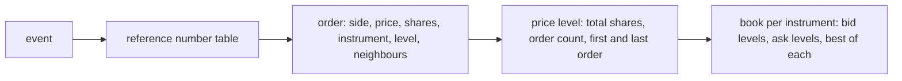

# 002 — Order book

**Status:** Agreed · **Updated:** 2026-10-25

## Proposal

The books for every instrument on the feed, built order by order from TotalView-ITCH 5.0's Add,
Execute, Cancel, Delete and Replace events: each displayed order, the price levels they make, and
the best bid and offer. It is component 7 of note 001, first in Shep's order because every other
component exists to feed it or to read it.

It also builds the **reference book** (note 001, D3): the same events applied by code written for
clarity, not speed. It is the oracle every test compares against and the baseline every
measurement is set beside.

It does not decode messages (note 004), route them (note 003) or publish (note 008). Its input is
an event, already decoded; its output is the changed state, which those notes take further.

## Design

**What the events say** (TotalView-ITCH 5.0, sections 1.3 to 1.4):

| Event | Carries | Effect on the book |
|---|---|---|
| Add Order (`A`, `F`) | reference number, side, shares, price, instrument (`F`: also the market participant) | a new order at the back of its price level |
| Order Executed (`E`) | reference number, shares executed | the order's shares reduced; removed at zero |
| Order Executed with Price (`C`) | as `E`, and the execution price | as `E`: the display price does not change |
| Order Cancel (`X`) | reference number, shares cancelled | the order's shares reduced |
| Order Delete (`D`) | reference number | the order removed |
| Order Replace (`U`) | old and new reference numbers, new shares and price | the old order removed; a new order, same side and instrument, at the back of its new level |

Every message carries the instrument's Stock Locate code, but only Add carries the side and price.
So every other event first finds its order by reference number, a number the specification calls
day-unique. That lookup, not the price levels, is the step every event pays. Prices are integers
with four implied decimals, at most 200,000.0000; shares are 32-bit.

Trades of non-displayed orders (`P`), cross trades (`Q`) and broken trades (`B`) do not change the
displayed book (the specification says so); they are note 003's.

**The structures:**

- **Orders** live in one pool of fixed-size records, allocated at start. An order points to its
  level and to its neighbours in that level's queue, so removing one is constant time.
- **Price levels** hold the total displayed shares, the number of orders and the first and last
  order, the queue in time priority. Consumers that care about queue position (note 008) can
  walk it; consumers that want depth read the totals.
- **A book** per instrument, indexed by Stock Locate code (a small integer assigned each day, meant
  as an array index), with each side's levels and its best price.

**Decisions** (each with what is proposed):

- **D1. Finding an order by reference number.** Built three ways and measured on the sample day:
  - *A.* `std::unordered_map` (what the reference book uses);
  - *B.* open addressing over a fixed-capacity table, allocated and pre-faulted at start, as the
    gateway's order book does (its note 007, and the page-fault lesson of its note 008);
  - *C.* a direct array indexed by the reference number less a base. The specification promises
    only uniqueness. On the sample day the numbers run from 8 to 494,466,152 for 223 million new
    orders (Add and Replace), so about 45% of the range is ever used, and they do not arrive in
    increasing order (159 million are below the highest seen before them). An array of 32-bit
    pool indexes over that range is 2.0 GB, nearly all of it touched over the day, against at
    most 1.93 million orders live at once: memory and TLB misses against one hashing step. A
    number outside the range must fall back to B.
  *Proposed:* all three built and measured; the default chosen from the figures.
- **D2. Keeping price levels per side.** Built and measured:
  - *A.* `std::map` from price to level (the reference book);
  - *B.* a sorted array of levels, best at the end, since most changes happen near the best;
  - *C.* an array indexed by price in ticks around the best, recentred when the best moves far.
    Ticks are not uniform (prices below $1.00 trade in sub-pennies), which C must handle.
  *Proposed:* all three built and measured; the default chosen from the figures.
- **D3. Queue position.** *Proposed:* each level keeps its orders in time priority (an intrusive
  doubly linked list through the order records), so a consumer can see where an order stands.
  *Alternative:* totals only (shares and count per level): cheaper by the list upkeep, but loses
  what a market-by-order feed offers over a price-level feed.
- **D4. Capacity.** *Proposed:* every structure sized at start from configuration (orders live at
  once, instruments, levels per side), allocated and pre-faulted; nothing allocates while events
  are applied. Running out is not a crash: the event is refused, the instrument's book is marked
  unreliable (note 001's principle), and the count of such refusals is reported. The defaults
  come from the sample day's peaks, with headroom stated: 1,925,638 orders live at once (at 15:57,
  just before the close), Stock Locate codes up to 8,915 (the field is 16-bit), 5,482 price levels
  in the busiest book. *Proposed defaults:* 4 million orders, 65,536 instruments; the level
  capacity once D2's structures are built, from the peak of all books together.
- **D5. Bad events.** An Execute, Cancel or Delete for an unknown reference number, a Cancel for
  more shares than remain, an Add reusing a live reference number: each means a message was missed
  or misapplied. *Proposed:* never applied silently: counted, the book marked unreliable, and the
  event left for note 005's recovery to explain. The reference book flags the same events, so a
  difference between the two is a bug in one of them.
- **D6. Locked and crossed books.** Whether the displayed Nasdaq book can show a bid at or above
  the offer is not stated in the specification. On the sample day, after 4,821 order events a
  book was crossed and after 19 it was locked. 4,363 of the crossed (90%) and all the locked were
  in instruments halted, paused or in a quotation-only period (Stock Trading Action states `H`,
  `P`, `Q`), when orders rest without matching; 458 were in instruments trading (`T`), unexplained
  as yet. *Proposed:* a book may be locked or crossed only outside state `T`; the 458 are explained
  before the invariant is set (an earlier state change missed, an auction, or an error of ours),
  and the finding recorded here.
- **D7. Input for this note's tests and figures, before the decoder exists.** Note 004 builds the
  decoder, after this note. *Proposed:* a small extraction tool, outside the hot path and not
  part of the handler, writes the sample day's order events in sequence into a compact file of
  fixed-size records in `data/`; this note's tests and benchmarks read that. Note 004 then checks
  its own decoder produces the same events. Synthetic events alone would bias the measurement,
  as the gateway learnt (its note 002: cyclic inputs made decoding look faster than it is).

**The reference book.** `std::map` and `std::unordered_map`, no pools, no tricks; it keeps the
same queue order (D3) and flags the same bad events (D5). After every event, tests compare the
changed level and both bests; at checkpoints, every level of every book.

**Invariants**, checked after every event in tests: a level's shares are the sum of its orders'
and its count their number; no order has zero or negative shares; every order is in exactly one
level of its instrument's side; the best price is the best level present; plus D6's rule once
measured.

**How it is measured** (on the harness of `lockfree-ipc`, as the gateway's stage costs were): the
cost of applying each event, by type, each call timed, as percentiles, after a discarded
warm-up; the whole day's events applied as fast as possible, as events a second; memory in use
at the day's peak. The fast book beside the reference book, and each alternative of D1 and D2
beside the others.

## Spec

- S1. Applying the sample day's order events, the fast book equals the reference book after every
  event (the changed level and both bests) and in full at checkpoints, for every combination of
  D1 and D2 alternatives built.
- S2. The invariants hold after every event of the sample day and of every hand-built test.
- S3. Every bad event of D5 is counted and marks its book unreliable, in both books alike; tests
  cover each kind.
- S4. Applying an event makes no allocation or system call (checked in the compiled code, as in
  the gateway).
- S5. Per-event cost by type, whole-day throughput and peak memory are published for every D1 and
  D2 alternative and for the reference book, as ranges over at least three runs, via
  `run.py report`.
- S6. D6's finding on locked and crossed books, with its counts from the sample day, is recorded,
  and its rule is an invariant.

## Tasks

- [ ] The repo's build: CMake, warnings as errors, `lockfree-ipc` fetched at a pinned commit,
      CTest; CI as the gateway's (x64, TSan, ASan/UBSan, arm64)
- [ ] The sample day fetched by a script, size and SHA-256 checked (note 001)
- [ ] D7: the extraction tool and the event file; counts of each event type
- [x] D1, D4, D6 from the data: reference-number density, peak live orders, instruments, levels,
      locked and crossed books; recorded here before the code (Review)
- [ ] D6: explain the 458 crossed books in state `T`
- [ ] The reference book; the invariants; hand-built tests of every event and every bad event
- [ ] The fast book: D1 A–C, D2 A–C, D3, D4, D5
- [ ] S1, S2 over the sample day; S4's call-graph check
- [ ] The benchmark and the report (S5)

## Review

| Date | Stage | Finding |
|---|---|---|
| 2026-10-25 | Draft | Written for review from TotalView-ITCH 5.0, sections 1.3 to 1.5 (read today: the order messages, and that `P`, `Q` and `B` do not change the displayed book). **The sample day, in figures** (30 January 2020, SHA-256 `8f5399155242f8d84338c36fdd78a47c0b0aa3df5707829b20c5158c258364c6`, 5,597,158,940 bytes as listed; read once by a throwaway program outside the repo, a plain map-based book, 152 s for the day): 423,285,709 messages, 12.95 GB uncompressed. Order events: Add 184,735,355 (`A`) and 1,875,350 (`F`), Delete 180,285,101, Replace 36,777,372, Executed 8,415,610, Cancel 4,990,972, Executed with Price 139,474. Every Execute, Cancel, Delete and Replace found its order (none unknown), and none was live at the end. Other types: `I` 4,025,192, `P` 1,779,727, `L` 216,802, `Q` 17,835, `Y` 9,068, `H` 8,921, `R` 8,916, `S` 6, `J` 5, `K` 2, `V` 1. Reference numbers, peaks and locked and crossed books: in D1, D4 and D6 |
| 2026-10-25 | Agreed | Approved by Shep, every decision as proposed (option A each): D1 and D2 three ways each, chosen from the figures; D3 queue position kept; D4 fixed capacity, pre-faulted, unreliable rather than a crash when full; D5 bad events counted and marking the book unreliable; D6 locked or crossed only outside state `T`, once the 458 are explained; D7 an extraction tool and event file until the decoder exists |
