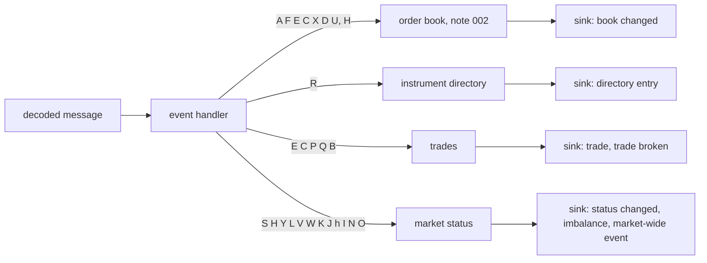

# 003 — Event handler, instrument directory, trades and market status

**Status:** Measured · **Updated:** 2026-10-26

## Proposal

Components 5, 6 and 8 of note 001, in one note because they meet in one place: every decoded
TotalView-ITCH 5.0 message goes to the **event handler**, which sends it to the state it changes.
Order messages go to the order book (note 002). The day's Stock Directory goes to the
**instrument directory**. Trades, trading status, auctions and market-wide events go to the
**trades and market status** tracker, which is kept apart from the displayed book, as Shep's
overview asks.

What changed is passed on to whatever consumes it, the publisher of note 008, through an interface
this note defines. It does not decode bytes (note 004), check sequence numbers (note 005) or
publish (note 008).

## Design

**What arrives** (TotalView-ITCH 5.0, sections 1.1 to 1.8), with the sample day's counts:

| Type | Message | Sample day | Goes to |
|---|---|---|---|
| `S` | System Event: start and end of messages, system and market hours | 6 | status, market-wide |
| `R` | Stock Directory: symbol, market category, financial status, round lot, ETP fields | 8,916 | directory |
| `H` | Stock Trading Action: halted, paused, quotation only, trading | 8,921 | status; the book (its D6 state) |
| `Y` | Reg SHO short-sale price test | 9,068 | status |
| `L` | Market Participant Position | 216,802 | status |
| `V`, `W` | Market-Wide Circuit Breaker levels and breach | 1, 0 | status, market-wide |
| `K` | IPO Quoting Period Update | 2 | status |
| `J` | LULD Auction Collar | 5 | status |
| `h` | Operational Halt, per Nasdaq market | 0 | status |
| `A`, `F`, `E`, `C`, `X`, `D`, `U` | order messages | 417,219,234 | the book; `E` and `C` also trades |
| `P` | Trade, non-displayed orders | 1,779,727 | trades |
| `Q` | Cross Trade, the auction's bulk print | 17,835 | trades |
| `B` | Broken Trade | 0 | trades |
| `I` | Net Order Imbalance Indicator | 4,025,192 | status (the auctions) |
| `N` | Retail Price Improvement Indicator | 0 | status |
| `O` | Direct Listing with Capital Raise | 0 | status |

**What the sample day showed** (a throwaway program over the whole day, outside the repo):

- No Add Order arrives before its instrument's Stock Directory message; no Stock Trading Action
  either.
- One instrument gets a second directory message during the day (locate 2396, ELAT, at 08:17).
- **Match numbers repeat.** 10,347,476 distinct match numbers, 5,170 of them twice: first on an
  Executed with Price (`C`), then on an Executed (`E`, 5,037), a Trade (`P`, 127) or another `C` (6).
  Every repeat has the same shares on the same instrument: one trade reported twice. **Corrected
  when built** (Review): every one of them is first a non-printable `C`, then a printable report,
  so counting printable reports only, as the specification says, already counts each once.
  Counting by match number (D5) stays, as the rule that holds even when it does not: a trade
  reported printable twice would otherwise count twice.
- 8,615 executions are marked non-printable (`C` with Printable `N`), 4.2 million shares. The
  specification says they are included in a later bulk print (`Q`), so they are left out of
  volume. Not an invariant, though: the day's `Q` prints total 132 million shares, far more than
  the non-printable executions before them, since a cross also matches orders never displayed.
- No broken trades, so `B` is tested by hand only.

**The handler** is sans-I/O, like the book: a decoded message in, state changed, the changes
reported to a sink, no sockets, clocks or threads inside. One thread owns all of it (note 001's
principle).

**Decisions** (each with what is proposed):

- **D1. What the handler takes.** *Proposed:* one decoded form per message type, defined here:
  a fixed struct of the specification's fields in host byte order (prices as integers with
  their stated decimals, symbols as 8 bytes, timestamps in nanoseconds), and a tagged union of
  them. Note 004 builds the decoder that fills them. Meanwhile a **reference decoder**, written
  for clarity (the extraction tool's plain decoding, extended to every type), fills them for the
  tests here; note 004's decoder is then held to it, as the fast book was held to the reference
  book. *Alternative:* the handler reads fields from the raw bytes through accessors (no decode
  step). That is a decoder question, note 004's to measure; the structs keep this note
  independent of the answer.
- **D2. What the handler reports.** *Proposed:* a sink, a template parameter with a call for each
  kind of change: book changed (the book's `applied`, note 002), trade (instrument, price, shares,
  match number, kind: displayed, non-displayed or cross), trade broken, an instrument's status
  changed (which field), imbalance (the latest `I`), market-wide event (`S`, `V`, `W`), directory
  entry. Calls into the sink are direct and inlined, with no queue or allocation; the publisher
  of note 008 is one sink, a test recorder another.
- **D3. The price of an execution.** `E` gives no price or side; they are the order's. *Proposed:*
  the handler looks the order up in the book before applying an `E` or `C` (`find`, note 002).
  That's a second lookup, on 2% of the day's events, and note 002's measured code is left as it
  is. *Alternative:* the book's `applied` extended to report the executed order's side and price:
  no second lookup, but a change to a Measured component and its figures.
- **D4. The directory.** *Proposed:* an array of entries indexed by Stock Locate (65,536; the field
  is 16-bit), and an index from symbol to locate (open addressing on the 8-byte symbol, fixed
  capacity) for consumers that ask by symbol. A second directory message for the same locate
  replaces the entry and is counted (ELAT on the sample day). A message for a locate with no entry
  is applied (the book does not need the directory) and counted, and the instrument is flagged as
  having no directory entry (none on the sample day).
- **D5. Trades, by match number.** *Proposed:* each trade reported once, the first time its match
  number is seen; a second execution with the same number is the other side of the same trade,
  not reported again (D2's trade call says which sides were seen). Per instrument: last price,
  volume and trade count, from printable executions (`E`, and `C` marked printable), `P` and
  `Q`; non-printable `C` left out (specification, 1.4.2). A fixed table from match number to the
  trade (instrument, shares, price, counted or not), sized from the day (10.3 million) with
  headroom, so a Broken Trade (`B`) can take its trade back out of volume and report it. A `B`
  for an unknown match number is counted, and its instrument flagged.
- **D6. Status.** *Proposed:* per instrument: trading state (`H`, and the book's D6 rule uses it),
  Reg SHO (`Y`), operational halt per Nasdaq market (`h`), LULD collar (`J`), IPO quoting period
  (`K`), retail interest (`N`), direct-listing price discovery (`O`), the latest imbalance (`I`).
  Market-wide: the system event phase (`S`, checked to come in the specification's order), the
  circuit-breaker levels and breach (`V`, `W`). Market participant positions (`L`) in a fixed table
  keyed by instrument and MPID, sized from the day's count of distinct pairs (measured when
  built).
- **D7. Correctness.** *Proposed:* as for the book (note 001, D3): a **reference handler**,
  standard containers throughout, fed the same messages, compared after every message on what the
  sink was told and on the changed instrument's directory entry, status and trade figures; and
  in full at checkpoints. Over the sample day, both from the reference decoder.
- **D8. Measurement.** *Proposed:* the handler's cost per message type with the default book behind
  it (note 002), timed per call as note 002 does, and the whole day through it as messages a
  second; beside the reference handler with the reference book.

## Spec

- S1. Every message type of TotalView-ITCH 5.0 is handled: each by a hand-built test of what it
  changes and what the sink is told; an unknown type is counted, never fatal.
- S2. Over the sample day, the handler equals the reference handler after every message (the sink's
  calls, the changed instrument's entry, status and trade figures) and in full at checkpoints; the
  book behind it equals the reference book (note 002's S1, through the handler).
- S3. Volume is counted once per match number: on the sample day, the 5,170 repeated match numbers
  each give one trade; the non-printable executions are left out; a Broken Trade takes its trade
  back out (by hand-built test).
- S4. Directory edge cases are counted and flagged, never fatal: a second entry for a locate, a
  message for a locate with no entry, a Broken Trade for an unknown match number.
- S5. Handling a message makes no allocation or system call (checked in the compiled code, as for
  the book).
- S6. The handler's cost per message type and the whole day's messages a second are published
  beside the reference handler's, as ranges over at least three runs, via `run.py report`.

## Tasks

- [x] The decoded forms of every message type (D1); the reference decoder; hand-built tests of it
      against the specification's layouts
- [x] The directory (D4), trades (D5) and status (D6); the handler and its sink (D2, D3)
- [x] The reference handler (D7); hand-built tests of every type (S1, S3, S4)
- [x] The sample day through both, from the reference decoder (S2, S3)
- [x] S5's call-graph check
- [x] The benchmark and the report (S6)

## Review

| Date | Stage | Finding |
|---|---|---|
| 2026-10-26 | Draft | Written for review from TotalView-ITCH 5.0, sections 1.1 to 1.8 (read today). The sample day's facts above come from a throwaway program over the whole day, outside the repo: no order before its directory entry; one second directory entry (locate 2396, ELAT, 08:17); 10,347,476 distinct match numbers, 5,170 repeated, each repeat the same shares and instrument (one trade, both sides reported); 8,615 non-printable executions (4,170,381 shares); `Q` prints 132,085,647 shares, 12,060 of the 17,835 with zero shares; no broken trades |
| 2026-10-26 | Agreed | Approved by Shep, every decision as proposed (option A each): D1 decoded structs per type and a reference decoder; D2 a sink; D3 the order looked up before an execution, note 002 unchanged; D4 directory by locate with a symbol index; D5 trades by match number; D6 status per instrument and market-wide; D7 a reference handler; D8 measured beside it |
| 2026-10-26 | Agreed (tasks) | **Built so far.** `messages.hpp` (every type's decoded form, 64 bytes as a tagged union), `reference_decoder.hpp`; `reference_decoder_test`: every type built byte by byte from a table of the specification's offsets transcribed apart from the decoder, each table checked to tile its type's length, every field compared; wrong lengths and unknown types refused (26 checks). `fixed_map.hpp` (fixed open addressing, never erased within a day), `directory.hpp`, `trades.hpp` (by match number), `market_status.hpp`, `handler.hpp` (the sink of D2; D3's lookup before an execution), `reference_handler.hpp` (standard containers). `handler_test`: every type by hand in both handlers, S3's trade rules, S4's edge cases, and 50,000 random messages of every type with both in lockstep (sink calls, counts, state); shown to catch two faults put in on purpose (a match number counted at every sighting; every C taken as printable). Clean under ASan/UBSan and TSan. S5: `check_hot_path` holds the handler on the default book (with a sink that does nothing) to note 002's rule: five functions, only memory functions and the stack protector. `handler_bench` and the report's handler section written; a check run on the day's first 20 million messages, outside bench mode: 8.31 M messages a second against the reference handler's 1.71 M, nothing refused |
| 2026-10-26 | Agreed (S2, S3) | **The sample day through both handlers** (`handler_day_test`): all 423,285,709 messages decoded, the handler (default book) and the reference handler (reference book) alike after every message and at 42 checkpoints and the end (every instrument, the counts, the market state, both books in full); one second directory entry, no other edge case; the System Events in order; nothing live at the close; 657 s. **S3's expectation was wrong, and the Draft's reading of the day with it.** The test expected executions arriving with a match number already counted, and found none. A throwaway pass over the day showed why: each of the 5,170 repeated match numbers is first a non-printable `C` (not counted), then a printable `E` (5,037), `P` (127) or `C` (6), counted there, once. So the repeats never risked double counting when only printable reports count; the Draft said counting by execution would count them twice, true only if non-printable reports were counted too. Of the day's 8,615 non-printable executions, then, 5,170 are printed by the other report of the same match and 3,445 by a bulk print. D5's rule stays (a trade reported printable twice), tested by hand; the day's test now counts both kinds of repeat. Re-run: all checks pass (5,170 seen again after a non-printable execution, none after a counted trade); 10,331,971 trades, 1,302,126,625 shares; 642 s |
| 2026-10-26 | Built (runs) | **Published:** `results/handler-dev-lnx01-20261026T135441Z.json`, `…141136Z`, `…142831Z` (`32fab72`, clean, bench mode, one session; every message decoded, nothing refused). The whole day, already decoded, on CPU 2: the handler on the default book 7.15–7.23 M messages a second, p50 151–152 ns, p99 543–558, p99.9 801–817, max 17.7–21.4 µs, peak 3,274 MB; the reference handler on the reference book 1.19–1.20 M, p50 816–820, max 516 ms (its maps growing; the match table alone holds 10.3 million trades), peak 1,052 MB. By type, the handler: Add 149–150 ns p50, Delete 144–145, Replace 263–267; Executed 315–318 and Executed with Price 286–290 (the order looked up first, D3, and the trade recorded); a non-displayed Trade 220–221 and an NOII 44, so recording a trade in the match table costs about as much as an order event (a 768 MB table: a cache miss a trade). Against the Spec: S1 (`reference_decoder_test`, `handler_test`), S2 and S3 (`handler_day_test`, above), S4 (`handler_test`, and on the day), S5 (`check_hot_path`), S6 (these runs, by message type in RESULTS.md). For Shep's review for Measured |
| 2026-10-26 | Measured | Reviewed and approved by Shep against the Spec: S1–S6 met as recorded above, with the correction to the repeated match numbers |
