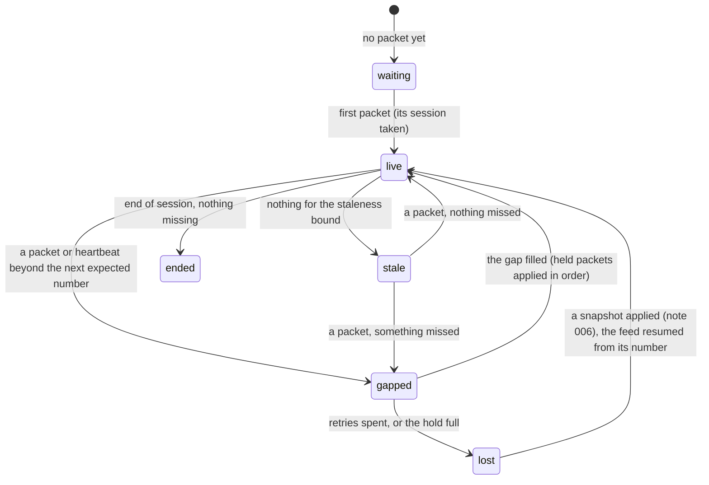

# 005 — Sequencing and recovery

**Status:** Measured (D2 amended) · **Updated:** 2026-10-26

## Proposal

Component 3 of note 001: between the receiver (note 007) and the decoder (note 004), it keeps the
feed's messages in sequence, drops duplicates, detects missing ones, recovers them, and says, all
the while, whether what the handler has applied is complete. This is where note 001 put the risk:
a missed message leaves a wrong book that looks right.

It is sans-I/O like the rest: MoldUDP64 packets in (as bytes, from whatever socket or test), and
out come messages in sequence, re-request packets to send, and changes of reliability state. It
also builds **the re-request server** (note 001, D1): the other side, keeping the session's
messages and answering requests, so recovery can be tested and measured. Sockets and the sender
are note 007's; snapshots, the recovery of last resort, note 006's.

## Design

**MoldUDP64, as specified** (V1.00): a downstream packet is a 20-byte header (session, 10 bytes;
the sequence number of its first message, 8; a message count, 2) and the messages, each after a
2-byte length; the messages after the first are numbered implicitly. A count of 0 is a heartbeat
and 0xFFFF the end of the session, both carrying the next expected sequence number. A request
packet (session, first sequence number, count) asks a re-request server for messages, answered
by ordinary downstream packets sent unicast to the asker, at most what fits in one packet each.

**The sequencer's state:**

Every change of state goes to the handler's sink (note 003, D2) for the publisher (note 008):
consumers see `live`, or why not.

**Decisions** (each with what is proposed):

- **D1. What waits during a gap.** Everything after a gap must wait: a later Delete may name an order
  whose Add is in the gap, so applying it early is a wrong book. *Proposed:* **hold** the packets
  that arrive after the gap, in a fixed buffer, and apply them in order once it is filled.
  Nothing already received is asked for again. *Alternative:* the specification's example
  receiver: discard them and re-request everything from the gap on. Simpler, but a gap of one
  packet costs the re-request of every packet behind it.
- **D2. Re-requests.** *Proposed:* on seeing a gap, one request for exactly its range (split into
  requests of what one packet holds); no answer within a timeout (default 1 ms: a loopback round
  trip is about 7 µs, a 10GBASE-T one about 40 µs, note 005 of the gateway), the outstanding part
  asked again, up to a number of retries (default 5), then `lost` (D4). A request is never sent
  twice within the timeout.
  *Amended (agreed with Shep, option A, from note 007's build):* the split requests are in flight
  together, up to a window (default 16), each for 26 messages (the fewest a full 1,400-byte packet
  holds, so answers overlap rather than leave holes; the duplicates are dropped, D3); the window is
  topped up as answers move the gap on, and asked again from its front after the timeout. The
  build had sent one request at a time (see Review).
- **D3. Duplicates and reordering.** *Proposed:* a message numbered below the next expected is a
  duplicate, dropped and counted; a packet beyond it is held (D1). The hold is ordered by
  sequence number, so reordering needs nothing more.
- **D4. Giving up.** *Proposed:* `lost` when the retries are spent, or when the hold is full
  (default 64 MB of packets, about a second of the busiest moments, to be measured): the books
  are no longer trusted, and recovery is by snapshot (note 006), which says from which sequence
  number to resume; the hold is then emptied up to it and the rest applied.
- **D5. Silence.** *Proposed:* `stale` when nothing (packet or heartbeat) arrives within a bound
  (default 2 s, twice the specification's typical heartbeat interval of 1 s); a heartbeat
  carrying a number beyond the next expected is a gap at the tail, re-requested like any other.
  A packet of another session is refused and counted.
- **D6. The re-request server.** *Proposed:* it keeps every message of the session, in order (the
  sample day's 12.95 GB fit this machine's memory), indexed by sequence number, and answers a
  request with downstream packets of the requested messages, as many as fit in a packet each,
  under the same payload bound as the sender.
- **D7. Packets.** Nasdaq's grouping of messages into packets is not in the recorded files.
  *Proposed:* messages in feed order, as many as fit in a payload of 1,400 bytes (an Ethernet
  frame less the IP and UDP headers, with room to spare), so the tests and the sender (note 007)
  agree.
- **D8. Correctness.** *Proposed:* an in-memory lossy link between the server and the sequencer
  that drops, duplicates, reorders and delays packets, and loses requests too, by pattern and at
  random (fixed seeds). The sample day through it at several loss rates, the handler behind:
  every message delivered once, in order, the books equal to the reference book's (note 002)
  whenever the sequencer says `live`.
- **D9. Measurement.** *Proposed:* the sequencer's cost per packet with nothing lost (it is on
  every packet's path), in process; and, through the in-memory link, the time from a gap's
  detection to its fill against the gap's size, and how many messages are held meanwhile.
  Recovery over a real network is note 007's and note 010's.

## Spec

- S1. Through the lossy link at every loss pattern and rate tested, the sample day's messages are
  delivered exactly once and in order, and the books equal the reference book's whenever the
  state is `live`.
- S2. A gap is detected on the first packet or heartbeat beyond it, and asked for exactly (its
  range, split to fit packets); a lost request is asked again after the timeout, and no
  request repeats within it.
- S3. Every change of state reaches the sink; while not `live`, nothing held is applied out of
  order.
- S4. A full hold or spent retries give `lost`; a snapshot's resume point empties the hold up to
  it (shown with a stand-in snapshot until note 006). A packet of another session is refused;
  the end of session is handled.
- S5. The in-order path makes no allocation or system call; the hold is fixed.
- S6. The cost per packet in order, and recovery time and messages held against gap size, are
  published as ranges over at least three runs, via `run.py report`.

## Tasks

- [x] The MoldUDP64 packet: reading and building (downstream, request), checked against the
      specification's layouts
- [x] The sequencer (D1–D5) and the re-request server (D6); D7's packetizer
- [x] The lossy link (D8); hand-built cases of every pattern; the sample day through it (S1–S4)
- [x] S5's call-graph check
- [x] The benchmark and the report (S6)

## Review

| Date | Stage | Finding |
|---|---|---|
| 2026-10-26 | Draft | Written for review from the MoldUDP64 specification V1.00 (read today: the downstream and request packets, heartbeats, end of session, and the example receiver, which discards what follows a gap and re-requests from it) |
| 2026-10-26 | Agreed | Approved by Shep, every decision as proposed (option A each): D1 hold what follows a gap; D2 exact re-requests, 1 ms timeout, 5 retries; D3 duplicates dropped, reordering held; D4 `lost` on spent retries or a full hold (64 MB), then a snapshot; D5 `stale` after 2 s of silence; D6 a re-request server keeping the whole session; D7 1,400-byte payloads in feed order; D8 an in-memory lossy link, the day through it; D9 cost per packet and recovery time against gap size |
| 2026-10-26 | Agreed (tasks) | **Built so far.** `mold.hpp` (downstream and request packets, read with every block checked to fit, built into a caller's buffer), `session_store.hpp` (the session's messages by sequence number: the packetizer of D7 and the re-request server of D6), `sequencer.hpp` (D1–D5: a fixed hold of packet slots ordered by a min-heap on the first sequence number; the first number expected is configuration, default 1, so a session whose first packets are lost begins with a gap rather than from whatever arrives first). `tests/lossy_link.hpp`: simulated time, the store's packets sent in order with heartbeats and the end of session, and a link each way that drops, duplicates and delays by pattern or at random, answers subject to the same losses. `sequencer_test`: the layouts, and every pattern by hand (one packet, a burst of about 50, duplicates and reordering, a lost request, every request lost then a stand-in snapshot, a full hold, another session, a malformed packet, the tail, silence, a gap at the start), and random streams at 0.1%, 1% and 5% loss with 10% of requests lost. **Found by the random streams, fixed:** the retries were counted over a whole gapped stretch, so at 5% loss five timeouts on different gaps gave up; they now start again whenever the gap moves on, as D2 means. **And a constraint for D4:** the hold must cover the retries at the peak packet rate (the first random runs, a packet a microsecond into a 4 MB test hold, filled it during one 1 ms retry); the agreed 64 MB (about 47,000 packets) is half a second at 100,000 packets a second. Clean under ASan/UBSan and TSan |
| 2026-10-26 | Agreed (S5, the benchmark) | **S5:** `check_hot_path` holds a packet through the sequencer, and its timer, to the same rule: only memory functions and the stack protector. **Amendment to D9, for Shep at Measured:** the lossy link's times are simulated (its latencies are configured), so the time from a gap to its fill measured through it would report the configuration, not the code. `sequencer_bench` measures instead the sequencer's own work, on the bench CPU: each packet in order over the whole day; holding a packet that arrives after a gap; and the call that delivers a backlog of 10, 100, 1,000 or 10,000 held packets when the missing one arrives. **Found by it, fixed:** holding scanned the whole hold for a duplicate first, quadratic in the backlog (2.9 µs a packet behind 10,000 held); duplicates are now kept and come out beside their twins, delivering nothing (a slot each while a gap lasts, bounded by the duplicate rate): 358 ns. A check run on the day's first 640 MB, outside bench mode: in order 2.45 M packets a second (106 M messages), p50 395 ns a packet; held 358 ns; a backlog of 10,000 delivered in 2.57 ms (257 ns a packet) |
| 2026-10-26 | Agreed (S1) | **The sample day through the lossy link** (`sequencer_day_test`): packed into packets (D7), sent at 100,000 packets a second (simulated), at no loss and at 0.01%, 0.1% and 1% of packets lost and as many duplicated, 1% delayed and 1% of requests lost; the default decoder and the handler on the default book behind. At every rate: all 423,285,709 messages delivered once, in order, as stored; ended, nothing held; the book equal, every level and queue, to one fed the same messages directly. At 1%: 134,498 gaps (reordering counts: a delayed packet opens a gap until it comes), 139,425 requests (1,925 retried), 340,668 packets held, 6,001,080 duplicate messages dropped. About 77 s a rate. With S2–S4 by hand (`sequencer_test`), S1–S4 met |
| 2026-10-26 | Built (runs, not published) | **Three bench-mode runs at two levels** (`a90262b`, clean; kept outside the repo). Runs 1 and 2 agree closely; run 3 is 17–20% faster in everything: in order p50 345 ns a packet against 415–416 (2.82 against 2.31 M packets a second), held 294 against 370–386, a backlog of 10,000 2.27 against 2.73 ms. Nothing recorded tells run 3 apart: the environment blocks, the clock's calibration and the noise floor (a quiet CPU in all three) are the same. Agreed with Shep: find out before publishing. The benchmark now counts, per packet, cycles and instructions (with the effective clock from cycles over wall time), branch mispredictions, last-level cache misses, L1 data and data-TLB read misses (`bench/counters.hpp`; Broadwell's two fixed counters and four general ones, so no multiplexing, which the kernel's enabled and running times confirm), and records the process's huge pages: none (the kernel's THP setting is `madvise`, and nothing here asks), so the big buffers are in 4 KB pages, placed anew each run. Six runs to see how often each level comes and what differs |
| 2026-10-26 | Built (runs, not published) | **Six runs with the counters** (`2ad6dad`, clean, bench mode; kept outside the repo). The work is the same in every run: over the untimed in-order pass, 1,452 cycles, 1,828 instructions, 21.6 last-level misses and 0.34 TLB misses a packet, at 3.40 GHz, no multiplexing; holding (370 ns p50) and the backlogs (2.73 ms for 10,000) the same in all six. **Only the timed in-order pass moved:** p50 344 ns in two runs, 405–416 in four; that pass was not counted. The earlier run faster in everything did not recur. Two guesses tested: the median between two humps of a distribution (outside bench mode the whole distribution moves together, not the median alone, so no), and the clock during the timed pass (416 / 344 = 1.21, about this CPU's single-core turbo over its all-core: 3.4 / 2.8). The timed pass is now counted too; six more runs |
| 2026-10-26 | Built (runs, not published; amendment) | **Six runs with the timed pass counted too** (`ba89c8d`, clean, bench mode; kept outside the repo). The clock is not it: 3.40 GHz in the timed pass as in every other, in all six. This time every timed in-order pass agreed (p50 423 ns; the build changed, and with it the code's layout: 1,491 cycles a packet untimed, against 1,452 before), and **holding** moved: one run held at 334 ns and delivered a backlog of 10,000 in 2.29 ms, against 379–405 ns and 2.73 ms in the other five; the same instructions, branch mispredictions and L1 misses, but **half the data-TLB misses while holding** (0.20 a packet against 0.40–0.42) and 10% fewer cycles, and fewer in the backlog's delivery (0.60 against 0.66–0.67; 837 cycles against 920–923). A level that moves from one measure to another between runs, with the TLB misses, fits address translation over 4 KB pages, placed anew each run. **Amendment to D4, agreed with Shep (option A), to test it:** the hold in transparent huge pages (`zeroed_huge` in `memory.hpp`: the range marked `MADV_HUGEPAGE` before anything is faulted in, then `MADV_POPULATE_WRITE`; `sequencer_config::huge_pages`, default on), and the benchmark's packet buffer likewise; the benchmark records the process's huge pages with the hold. Checked: the 16 GB of packets and the 64 MB hold all in huge pages, no fallback (`thp_fault_fallback` 0). Six runs |
| 2026-10-26 | Built (runs) | **Six runs in huge pages** (`695b3bf`, clean, bench mode, one session): the 16 GB of packets and the hold all in huge pages, and the data-TLB misses near zero in every run (0.003–0.006 a held packet, against 0.40 before), **yet one run of six at the fast level still**: held 296 ns p50 and a backlog of 10,000 in 2.22 ms, against 371–374 ns and 2.69–2.70 ms (1,460 cycles a held packet against 1,714–1,732; last-level misses 36.3 against 38.0–38.9). So TLB misses are not the cause. Ruled out over the eleven counted runs: the clock, instructions, branch mispredictions, L1 misses, TLB misses. Left: the step shows only where packets are copied into and out of the 64 MB hold, memory-bound work (38 last-level misses a held packet, the hold larger than the 55 MB L3), so the suspect is where the hold lands in physical memory (its spread over the L3's slices and DRAM's channels and banks), which cannot be set or seen from user space. The in-order path, on every packet's way, is steady in all six: p50 428–429 ns, 2.30 M packets a second (104 M messages). Huge pages stay (agreed): they took the TLB misses away and the hold about 2% faster, though not the levels. **Published** (agreed with Shep, option A), all six: `results/sequencer-dev-lnx01-20261026T200100Z.json` to `…201134Z`; RESULTS gives the hold and backlog figures as ranges spanning both levels, and says so. Against the Spec: S1 (`sequencer_day_test`), S2–S4 (`sequencer_test`), S5 (`check_hot_path`), S6 (these runs, with D9 amended as above). For Shep's review for Measured |
| 2026-10-26 | Measured | Reviewed and approved by Shep against the Spec: S1–S6 met as recorded above, with D4 (huge pages) and D9 (the sequencer's own work) amended, and the two levels in the hold left open as recorded |
| 2026-10-26 | Measured (note) | **From note 007's build:** D2's timeout assumes an answer is read within a retry of its being sent. With answers on the multicast socket that fails once the receiver lags the sender by more than the retries (~5 ms), since they queue behind the backlog; note 007 amended its D1 (answers on a request socket of their own, read first while gapped). The sequencer is unchanged |
| 2026-10-26 | Measured (amendment) | **D2 amended, from note 007's day over loopback.** The build sent one request at a time, the next when an answer moved the gap on, though D2 as agreed splits a gap into requests of a packet each: a recovery of one packet a round trip (over loopback, with the receiver's pass and the sender's serving, about 30k packets a second), against a feed adding 100k a second to the hold, so a loss of more than about 14,000 packets filled the 64 MB hold and the feed was lost. Options put to Shep: A requests in flight together; B one at a time, the limit stated. **A agreed:** up to 16 requests of 26 messages each (`sequencer_config::window`, `request_step`), topped up as the gap moves on, the window asked again from its front on a timeout; a gap shorter than a step is still asked for exactly. `sequencer_test` gains the case: about 2,000 packets lost at 500,000 a second, a 2,048-packet hold: one in flight (`window` 1, the old behaviour) fills the hold and is lost; 16 recover it with no retry. Every other sequencer test unchanged and passing; clean under ASan/UBSan and TSan. The published figures (in order, held, backlog) do not send requests beyond a gap's first: not re-measured; to be confirmed by a check run |
| 2026-10-27 | Measured (check run) | **The published figures hold after D2's amendment.** A bench-mode check run at `e0af2a5` (clean; kept outside the repo): in order 2.31 M packets a second, p50 421 ns, p99 825 (published 2.30 M, 428–429, 810–811: 1.5% quicker at p50, within run-to-run spread for a changed build); held 320 ns p50 and a backlog of 10,000 delivered in 2.22 ms, the fast one of the two levels already recorded (published 296–374 ns, 2.22–2.70 ms); 3.40 GHz as before. Not republished |
