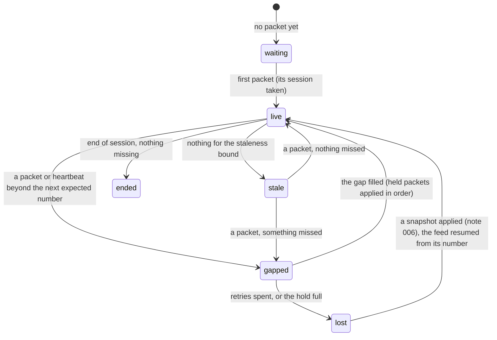

# 005 — Sequencing and recovery

**Status:** Agreed · **Updated:** 2026-10-26

## Proposal

Component 3 of note 001: between the receiver (note 007) and the decoder (note 004), it keeps the
feed's messages in sequence, drops duplicates, detects missing ones, recovers them, and says, all
the while, whether what the handler has applied is complete. This is where note 001 put the risk:
a missed message leaves a wrong book that looks right.

It is sans-I/O like the rest: MoldUDP64 packets in (as bytes, from whatever socket or test), and
out come messages in sequence, re-request packets to send, and changes of reliability state. It
also builds **the re-request server** (note 001, D1): the other side, keeping the session's
messages and answering requests, so recovery can be tested and measured. Sockets and the sender
are note 007's; snapshots, the recovery of last resort, note 006's.

## Design

**MoldUDP64, as specified** (V1.00): a downstream packet is a 20-byte header (session, 10 bytes;
the sequence number of its first message, 8; a message count, 2) and the messages, each after a
2-byte length; the messages after the first are numbered implicitly. A count of 0 is a heartbeat
and 0xFFFF the end of the session, both carrying the next expected sequence number. A request
packet (session, first sequence number, count) asks a re-request server for messages, answered
by ordinary downstream packets sent unicast to the asker, at most what fits in one packet each.

**The sequencer's state:**

Every change of state goes to the handler's sink (note 003, D2) for the publisher (note 008):
consumers see `live`, or why not.

**Decisions** (each with what is proposed):

- **D1. What waits during a gap.** Everything after a gap must wait: a later Delete may name an order
  whose Add is in the gap, so applying it early is a wrong book. *Proposed:* **hold** the packets
  that arrive after the gap, in a fixed buffer, and apply them in order once it is filled.
  Nothing already received is asked for again. *Alternative:* the specification's example
  receiver: discard them and re-request everything from the gap on. Simpler, but a gap of one
  packet costs the re-request of every packet behind it.
- **D2. Re-requests.** *Proposed:* on seeing a gap, one request for exactly its range (split into
  requests of what one packet holds); no answer within a timeout (default 1 ms: a loopback round
  trip is about 7 µs, a 10GBASE-T one about 40 µs, note 005 of the gateway), the outstanding part
  asked again, up to a number of retries (default 5), then `lost` (D4). A request is never sent
  twice within the timeout.
- **D3. Duplicates and reordering.** *Proposed:* a message numbered below the next expected is a
  duplicate, dropped and counted; a packet beyond it is held (D1). The hold is ordered by
  sequence number, so reordering needs nothing more.
- **D4. Giving up.** *Proposed:* `lost` when the retries are spent, or when the hold is full
  (default 64 MB of packets, about a second of the busiest moments, to be measured): the books
  are no longer trusted, and recovery is by snapshot (note 006), which says from which sequence
  number to resume; the hold is then emptied up to it and the rest applied.
- **D5. Silence.** *Proposed:* `stale` when nothing (packet or heartbeat) arrives within a bound
  (default 2 s, twice the specification's typical heartbeat interval of 1 s); a heartbeat
  carrying a number beyond the next expected is a gap at the tail, re-requested like any other.
  A packet of another session is refused and counted.
- **D6. The re-request server.** *Proposed:* it keeps every message of the session, in order (the
  sample day's 12.95 GB fit this machine's memory), indexed by sequence number, and answers a
  request with downstream packets of the requested messages, as many as fit in a packet each,
  under the same payload bound as the sender.
- **D7. Packets.** Nasdaq's grouping of messages into packets is not in the recorded files.
  *Proposed:* messages in feed order, as many as fit in a payload of 1,400 bytes (an Ethernet
  frame less the IP and UDP headers, with room to spare), so the tests and the sender (note 007)
  agree.
- **D8. Correctness.** *Proposed:* an in-memory lossy link between the server and the sequencer
  that drops, duplicates, reorders and delays packets, and loses requests too, by pattern and at
  random (fixed seeds). The sample day through it at several loss rates, the handler behind:
  every message delivered once, in order, the books equal to the reference book's (note 002)
  whenever the sequencer says `live`.
- **D9. Measurement.** *Proposed:* the sequencer's cost per packet with nothing lost (it is on
  every packet's path), in process; and, through the in-memory link, the time from a gap's
  detection to its fill against the gap's size, and how many messages are held meanwhile.
  Recovery over a real network is note 007's and note 010's.

## Spec

- S1. Through the lossy link at every loss pattern and rate tested, the sample day's messages are
  delivered exactly once and in order, and the books equal the reference book's whenever the
  state is `live`.
- S2. A gap is detected on the first packet or heartbeat beyond it, and asked for exactly (its
  range, split to fit packets); a lost request is asked again after the timeout, and no
  request repeats within it.
- S3. Every change of state reaches the sink; while not `live`, nothing held is applied out of
  order.
- S4. A full hold or spent retries give `lost`; a snapshot's resume point empties the hold up to
  it (shown with a stand-in snapshot until note 006). A packet of another session is refused;
  the end of session is handled.
- S5. The in-order path makes no allocation or system call; the hold is fixed.
- S6. The cost per packet in order, and recovery time and messages held against gap size, are
  published as ranges over at least three runs, via `run.py report`.

## Tasks

- [ ] The MoldUDP64 packet: reading and building (downstream, request), checked against the
      specification's layouts
- [ ] The sequencer (D1–D5) and the re-request server (D6); D7's packetizer
- [ ] The lossy link (D8); hand-built cases of every pattern; the sample day through it (S1–S4)
- [ ] S5's call-graph check
- [ ] The benchmark and the report (S6)

## Review

| Date | Stage | Finding |
|---|---|---|
| 2026-10-26 | Draft | Written for review from the MoldUDP64 specification V1.00 (read today: the downstream and request packets, heartbeats, end of session, and the example receiver, which discards what follows a gap and re-requests from it) |
| 2026-10-26 | Agreed | Approved by Shep, every decision as proposed (option A each): D1 hold what follows a gap; D2 exact re-requests, 1 ms timeout, 5 retries; D3 duplicates dropped, reordering held; D4 `lost` on spent retries or a full hold (64 MB), then a snapshot; D5 `stale` after 2 s of silence; D6 a re-request server keeping the whole session; D7 1,400-byte payloads in feed order; D8 an in-memory lossy link, the day through it; D9 cost per packet and recovery time against gap size |
