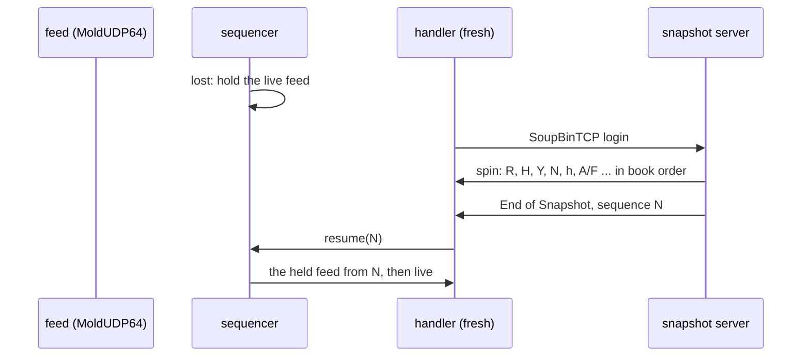

# 006 — Snapshots and replay

**Status:** Agreed · **Updated:** 2026-10-26

## Proposal

Component 10 of note 001: a starting state for a handler that joins late, and recovery when note
005's sequencer gives up on a gap (`lost`). A snapshot is the books and their instruments at one
sequence number. The handler rebuilds from it, then carries on from that number with the live
feed, which the sequencer has been holding meanwhile. As note 001 agreed (D4), the format is
Nasdaq's own: **GLIMPSE 5.0 over SoupBinTCP**, served by our own snapshot server.

Shep's overview said it, and this note holds to it: a snapshot restores the books, not the trade
history it missed.

It is sans-I/O like the rest: the snapshot as bytes, in memory. Sockets are note 007's.

## Design

**GLIMPSE 5.0** (revised 22 August 2024, read today): after a SoupBinTCP login, a spin of
TotalView-ITCH messages in their own formats: System Event, Stock Directory for every symbol,
Stock Trading Action, Reg SHO, Retail Price Improvement, Operational Halt, and an Add Order (`A`,
or `F` with its attribution) for every displayed order. Then an **End of Snapshot** message (`G`,
21 bytes), whose sequence number, unlike every other number in these feeds, is **20 ASCII
digits**: the TotalView-ITCH sequence number from which to process the live feed.

**SoupBinTCP 3.00:** each packet is a 2-byte length then a type: the client's Login Request
(username, password, requested session, requested sequence number in ASCII), the server's Login
Accepted (session, next sequence number in ASCII) or Rejected, Sequenced Data (one message each,
numbered implicitly from the login's number), Server Heartbeat, End of Session; and Debug packets
either way, to be ignored.

**What a snapshot cannot restore**, since GLIMPSE does not carry it: trades and volume so far
today, market participant positions, imbalances (NOII), LULD collars, IPO quoting periods,
direct-listing price discovery, and the circuit-breaker levels.

**Decisions** (each with what is proposed):

- **D1. The snapshot server's state.** *Proposed:* the server follows the feed itself, with the
  reference handler and reference book (notes 002 and 003) and a table of each live order's
  attribution, the MPID of its `F`, carried across a Replace as the specification says (1.4.5).
  It is off any measured path, so clarity wins. The fast book keeps no attribution and is not
  changed.
- **D2. A snapshot at an exact point.** *Proposed:* the spin is built between two messages, from
  the state after exactly the messages before N, N being the server's next expected sequence
  number, so the End of Snapshot's number is right by construction. It is written into memory
  in one go, then sent; the server takes no feed messages while it builds.
- **D3. The spin's order.** *Proposed:* the System Event phase reached; every Stock Directory;
  each instrument's Trading Action, Reg SHO, retail interest and operational halts; then every
  displayed order, instrument by instrument, each side best level first, **each level's orders
  in time priority**, so the client's queues come out in the same order (note 002, D3) with the
  same reference numbers (later Executes and Deletes name them); then End of Snapshot.
- **D4. The client.** *Proposed:* a fresh book and handler, fed the spin through the same
  decoder and handler as the live feed (note 001's principle: one path for recorded and live
  input); the old book is dropped at End of Snapshot, the new one takes its place, and the
  sequencer resumes at N (note 005's `resume`), applying the held feed from N. Until then
  consumers see the feed `lost`, then `live`.
- **D5. What is not restored, said.** *Proposed:* after a snapshot, each instrument's trade
  figures and the status fields GLIMPSE does not carry are marked "not since snapshot" (the
  handler's status gains that mark), until a live message sets them again; the publisher
  (note 008) passes the mark on.
- **D6. Correctness.** *Proposed:* snapshots taken at points across the sample day (every 50
  million messages, and at the day's peak of live orders): for each, the snapshot's own books
  equal the server's at N (a round trip), and a client rebuilt from it then fed the rest of the
  day equals the reference book after every later message and at the close. And through note
  005's lossy link: every request lost, so the sequencer gives up, and a snapshot brings it back
  to `live` and to the reference's books.
- **D7. Measurement.** *Proposed:* at each of those points: the spin's size (messages and bytes),
  the time to build it (server) and to apply it (client, fresh handler and default book), on CPU
  2 in bench mode; the time to apply it is the cost of a recovery, before catching up on what
  was held (note 005's backlog figures).

## Spec

- S1. A snapshot's own books, rebuilt by the client, equal the server's at its sequence number
  (every level and queue, time priority included), at every point tested on the sample day.
- S2. A client rebuilt from a snapshot at N and fed the day from N equals the reference book
  after every later message and at the close.
- S3. Every GLIMPSE and SoupBinTCP layout used is tested against the specifications (the End of
  Snapshot's ASCII number included), and Debug packets are ignored.
- S4. Through the lossy link, a sequencer that gives up is brought back to `live` by a snapshot,
  the books then equal to the reference's.
- S5. After a snapshot, the trade figures and status fields it cannot restore are marked as such
  until set again.
- S6. Spin size, build time and apply time at points across the day, including the peak, are
  published as ranges over at least three runs, via `run.py report`.

## Tasks

- [x] SoupBinTCP packets and the GLIMPSE End of Snapshot: reading and building, against the
      specifications (S3)
- [x] The snapshot server (D1, D2, D3) and the client's rebuild (D4, D5)
- [ ] The sample day: snapshots at points, round trip and catch-up (S1, S2); through the lossy
      link (S4)
- [ ] The benchmark and the report (S6)

## Review

| Date | Stage | Finding |
|---|---|---|
| 2026-10-26 | Draft | Written for review from GLIMPSE 5.0 (revised 22 August 2024) and SoupBinTCP 3.00, read today. Found there: the End of Snapshot's sequence number is 20 ASCII digits, not binary; the spin carries no trades, positions, imbalances, collars, IPO or circuit-breaker state |
| 2026-10-26 | Agreed | Approved by Shep, every decision as proposed (option A each): D1 a server following the feed with the reference handler and book and each order's attribution; D2 a snapshot between two messages; D3 the spin in book order, time priority kept; D4 a fresh client book fed the spin through the same path, then resume(N); D5 what is not restored marked; D6 snapshots across the day, round trip, catch-up and the lossy link; D7 size, build and apply times |
| 2026-10-26 | Agreed (tasks) | **Built so far.** `encoder.hpp` (a decoded message back to its wire bytes, from the decoder's own field tables run the other way), `soup.hpp` (SoupBinTCP packets built and read as a stream in any pieces, Debug ignored; GLIMPSE's End of Snapshot with its 20 ASCII digits), `snapshot.hpp` (the server, D1–D3; the client's rebuild, D4). **D5, an amendment to note 003's handler:** each instrument's status carries a mark of what a snapshot could not restore (`not_since_snapshot`: trades, LULD collar, IPO quoting, direct listing, imbalance, participant positions; the market's circuit breakers), set by `mark_restored()` and cleared by the live message that sets the field, trades never; a bit cleared on messages that already write that status, nothing on the order or trade path; both handlers, and the tests' comparisons include it. `snapshot_test`: the layouts; the encoder, a million random messages of every type decoded and encoded again, byte for byte; a server following a random stream (attributed orders among it), a client rebuilt at 4 points, fed the spin in pieces: the server's books (every level and queue), directory and restorable status, End of Snapshot's N; every F in the spin with its order's MPID; caught up from N to the end, equal; the marks set and cleared. Shown to catch the spin's queues in reverse order, put in on purpose. **S4:** through the lossy link, one packet and every request lost: the sequencer gives up; a snapshot at the lost packet's end rebuilds a fresh client, the sequencer resumes from N with what it held, and the books equal the reference's. Clean under ASan/UBSan and TSan |
