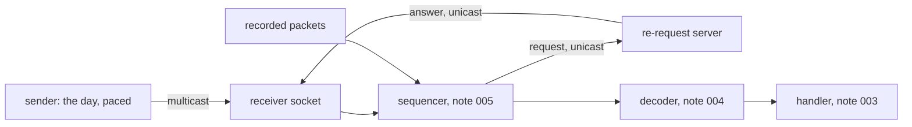

# 007 — Receiver and framer

**Status:** Draft · **Updated:** 2026-10-26

## Proposal

Components 1 and 2 of note 001: the feed's way in. The **receiver** owns the sockets and buffers:
it takes MoldUDP64 datagrams from a multicast group, sends re-requests over unicast and takes
their answers, and reads recorded input through the same path. The **framer** turns what arrives
into packets and messages, checking every boundary (MoldUDP64's blocks: `mold.hpp`, note 005;
SoupBinTCP's stream: `soup.hpp`, note 006; the recorded files' 2-byte lengths).

It also builds the other end: **our MoldUDP64 sender**, replaying a recorded day onto the group
at a chosen pace, with the re-request server (note 005, D6) answering on unicast. This is note
001's D1: we have no Nasdaq feed, so the live path runs against our own sender, over loopback and
over the machine's 10GBASE-T ports (the gateway's `card-link` setup: its two ports cabled
together, the far one in a network namespace).

This is where the work meets the kernel, so most of its decisions are measured.

## Design

**Decisions** (each with what is proposed):

- **D1. Taking datagrams.** *Proposed:* a non-blocking UDP socket joined to the group, read with
  `recvmmsg` in batches (up to 64 datagrams a call), each into its own buffer with the decoder's
  padding after it (note 004, D2: at least 32 readable bytes past every message, given here by a
  buffer of 1,500 + 64 bytes a datagram). *Alternative, measured beside it:* `recvmsg`, one
  datagram a call.
- **D2. Waiting.** *Proposed:* busy-polling the socket on the receiving CPU (the bench CPUs are
  reserved), with the kernel's own busy polling (`SO_BUSY_POLL`) measured on the card path, as the
  gateway did (its note 005, D2; over loopback it does nothing).
- **D3. Not losing datagrams in the kernel.** A full socket buffer drops datagrams silently; the
  sequencer then sees a gap and re-requests. *Proposed:* the buffer as large as the machine allows
  (`net.core.rmem_max` is 4 MB here: a few thousand datagrams at most, since the kernel charges
  each its whole buffer, not just its bytes; measured when built); every drop counted from the kernel's
  own count (`SO_RXQ_OVFL`, a count with each datagram); and the highest pace sustained without
  kernel drops measured for each setting. *Option for Shep:* raising `rmem_max` in bench mode
  (a sysctl in `bench-on`, restored by `bench-off`, so in lockfree-ipc's `tools/machine`), only
  if the 4 MB buffer is shown to drop at the day's pace.
- **D4. One thread or two.** *Proposed, both built and measured:* (a) one pinned thread
  receiving, sequencing, decoding and handling (note 001's principle: one owner of the state);
  (b) a receiving thread (socket and sequencer) handing messages to a handling thread through
  `lockfree-ipc`'s SPSC ring, so the socket is drained while a long handling step runs. The
  default chosen from the figures.
- **D5. Recorded input, through the same path.** *Proposed:* a recording is the datagrams as they
  were received (note 009 writes them), replayed into the sequencer as if from the socket, so
  everything from the sequencer on is the live code. The sample day, which is messages, not
  datagrams, is packed by note 005's packetizer first, as the sender does.
- **D6. The sender.** *Proposed:* its own process, on its own reserved CPU, replaying the day
  from a session store onto the group: at a fixed number of packets a second, or at the day's own
  pace (its timestamps), sped up by a chosen factor; heartbeats when it has nothing to send and
  the end of session after the last, as the specification has it. The same process answers
  re-requests on a unicast port from the same store. A loss setting drops a chosen share of
  packets before sending, so recovery is exercised over a real socket.
- **D7. Paths.** *Proposed:* loopback, and the card: the sender on the far port in the namespace,
  the receiver on ours, multicast routed over the cable. `card-link` is copied into this
  repository's `tools/` (it is the gateway's, written here) with a multicast route added.
- **D8. Receive timestamps.** *Proposed:* each datagram's kernel receive time (`SO_TIMESTAMPNS`)
  read with it, so the time from the kernel to the message being handled can be measured
  (note 010 measures the whole path, from the sender). The card stamps only PTP packets in
  hardware (the gateway's note 005), so these are the kernel's software stamps.
- **D9. Correctness.** *Proposed:* the sample day sent over loopback and over the card, at
  several paces and loss settings: every message handled once, in order, the books equal to
  the reference's at the end; kernel drops counted and recovered by re-request; a recording
  replayed gives the same books (note 001, S7, in part).
- **D10. Measurement.** *Proposed:* the receive path's cost per datagram (D1's two ways, D4's two
  ways), the highest pace sustained without kernel drops for the buffer setting, and the time
  from the kernel's receive stamp to a message handled, as percentiles, open loop, on loopback
  and on the card.

## Spec

- S1. Over loopback and over the card, at every pace and loss setting tested, the sample day's
  messages are handled once, in order, and the books equal the reference's at the end.
- S2. Every datagram dropped by the kernel is counted (`SO_RXQ_OVFL`) and its messages recovered
  by re-request.
- S3. Every boundary is checked: a datagram whose MoldUDP64 blocks do not fit, a truncated
  datagram, a SoupBinTCP packet longer than what arrived; each counted, never applied.
- S4. A recording of received datagrams, replayed, gives the same books as the live run.
- S5. The receive path makes no allocation; its system calls are the socket's own (`recvmmsg`,
  `sendto` for requests), checked in the compiled code.
- S6. Receive cost per datagram, the highest pace without kernel drops, and kernel-to-handled
  latency are published, loopback and card, for D1's and D4's alternatives, as ranges over at
  least three runs, via `run.py report`.

## Tasks

- [ ] The receiver (D1–D3, D8) and the sender with its re-request server (D6)
- [ ] D4's two arrangements; D5's replay of recorded datagrams
- [ ] `card-link` with a multicast route (D7)
- [ ] The sample day over loopback and the card (S1–S4); S5's call-graph check
- [ ] The benchmark and the report (S6)

## Review

| Date | Stage | Finding |
|---|---|---|
| 2026-10-26 | Draft | Written for review. On this machine today: `net.core.rmem_max` 4 MB (a receive buffer's ceiling without a sysctl), `busy_read` and `busy_poll` 0 |
