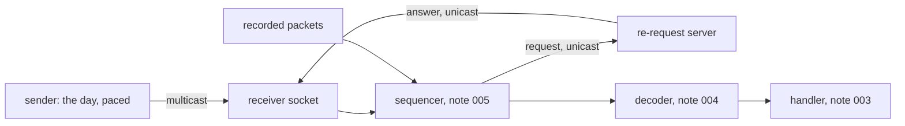

# 007 — Receiver and framer

**Status:** Agreed (D1 amended) · **Updated:** 2026-10-26

## Proposal

Components 1 and 2 of note 001: the feed's way in. The **receiver** owns the sockets and buffers:
it takes MoldUDP64 datagrams from a multicast group, sends re-requests over unicast and takes
their answers, and reads recorded input through the same path. The **framer** turns what arrives
into packets and messages, checking every boundary (MoldUDP64's blocks: `mold.hpp`, note 005;
SoupBinTCP's stream: `soup.hpp`, note 006; the recorded files' 2-byte lengths).

It also builds the other end: **our MoldUDP64 sender**, replaying a recorded day onto the group
at a chosen pace, with the re-request server (note 005, D6) answering on unicast. This is note
001's D1: we have no Nasdaq feed, so the live path runs against our own sender, over loopback and
over the machine's 10GBASE-T ports (the gateway's `card-link` setup: its two ports cabled
together, the far one in a network namespace).

This is where the work meets the kernel, so most of its decisions are measured.

## Design

**Decisions** (each with what is proposed):

- **D1. Taking datagrams.** *Proposed:* a non-blocking UDP socket joined to the group, read with
  `recvmmsg` in batches (up to 64 datagrams a call), each into its own buffer with the decoder's
  padding after it (note 004, D2: at least 32 readable bytes past every message, given here by a
  buffer of 1,500 + 64 bytes a datagram). *Alternative, measured beside it:* `recvmsg`, one
  datagram a call. *Amended (agreed with Shep, option A):* re-requests go from a second socket,
  the request socket (unicast, any free port on the interface), so their answers come back on it,
  out of the multicast queue; while the sequencer is gapped it is read first, otherwise it is left
  alone. With one socket an answer waits behind every multicast datagram not yet read, so a
  receiver behind the sender gave up (see Review).
- **D2. Waiting.** *Proposed:* busy-polling the socket on the receiving CPU (the bench CPUs are
  reserved), with the kernel's own busy polling (`SO_BUSY_POLL`) measured on the card path, as the
  gateway did (its note 005, D2; over loopback it does nothing).
- **D3. Not losing datagrams in the kernel.** A full socket buffer drops datagrams silently; the
  sequencer then sees a gap and re-requests. *Proposed:* the buffer as large as the machine allows
  (`net.core.rmem_max` is 4 MB here: a few thousand datagrams at most, since the kernel charges
  each its whole buffer, not just its bytes; measured when built); every drop counted from the kernel's
  own count (`SO_RXQ_OVFL`, a count with each datagram); and the highest pace sustained without
  kernel drops measured for each setting. *Option for Shep:* raising `rmem_max` in bench mode
  (a sysctl in `bench-on`, restored by `bench-off`, so in lockfree-ipc's `tools/machine`), only
  if the 4 MB buffer is shown to drop at the day's pace.
- **D4. One thread or two.** *Proposed, both built and measured:* (a) one pinned thread
  receiving, sequencing, decoding and handling (note 001's principle: one owner of the state);
  (b) a receiving thread (socket and sequencer) handing messages to a handling thread through
  `lockfree-ipc`'s SPSC ring, so the socket is drained while a long handling step runs. The
  default chosen from the figures.
- **D5. Recorded input, through the same path.** *Proposed:* a recording is the datagrams as they
  were received (note 009 writes them), replayed into the sequencer as if from the socket, so
  everything from the sequencer on is the live code. The sample day, which is messages, not
  datagrams, is packed by note 005's packetizer first, as the sender does.
- **D6. The sender.** *Proposed:* its own process, on its own reserved CPU, replaying the day
  from a session store onto the group: at a fixed number of packets a second, or at the day's own
  pace (its timestamps), sped up by a chosen factor; heartbeats when it has nothing to send and
  the end of session after the last, as the specification has it. The same process answers
  re-requests on a unicast port from the same store. A loss setting drops a chosen share of
  packets before sending, so recovery is exercised over a real socket.
- **D7. Paths.** *Proposed:* loopback, and the card: the sender on the far port in the namespace,
  the receiver on ours, multicast routed over the cable. `card-link` is copied into this
  repository's `tools/` (it is the gateway's, written here) with a multicast route added.
- **D8. Receive timestamps.** *Proposed:* each datagram's kernel receive time (`SO_TIMESTAMPNS`)
  read with it, so the time from the kernel to the message being handled can be measured
  (note 010 measures the whole path, from the sender). The card stamps only PTP packets in
  hardware (the gateway's note 005), so these are the kernel's software stamps.
- **D9. Correctness.** *Proposed:* the sample day sent over loopback and over the card, at
  several paces and loss settings: every message handled once, in order, the books equal to
  the reference's at the end; kernel drops counted and recovered by re-request; a recording
  replayed gives the same books (note 001, S7, in part).
- **D10. Measurement.** *Proposed:* the receive path's cost per datagram (D1's two ways, D4's two
  ways), the highest pace sustained without kernel drops for the buffer setting, and the time
  from the kernel's receive stamp to a message handled, as percentiles, open loop, on loopback
  and on the card.

## Spec

- S1. Over loopback and over the card, at every pace and loss setting tested, the sample day's
  messages are handled once, in order, and the books equal the reference's at the end.
- S2. Every datagram dropped by the kernel is counted (`SO_RXQ_OVFL`) and its messages recovered
  by re-request.
- S3. Every boundary is checked: a datagram whose MoldUDP64 blocks do not fit, a truncated
  datagram, a SoupBinTCP packet longer than what arrived; each counted, never applied.
- S4. A recording of received datagrams, replayed, gives the same books as the live run.
- S5. The receive path makes no allocation; its system calls are the socket's own (`recvmmsg`,
  `sendto` for requests), checked in the compiled code.
- S6. Receive cost per datagram, the highest pace without kernel drops, and kernel-to-handled
  latency are published, loopback and card, for D1's and D4's alternatives, as ranges over at
  least three runs, via `run.py report`.

## Tasks

- [x] The receiver (D1–D3, D8) and the sender with its re-request server (D6)
- [x] D4's two arrangements; D5's replay of recorded datagrams
- [x] `card-link` with a multicast route (D7)
- [ ] The sample day over loopback and the card (S1–S4); S5's call-graph check
- [ ] The benchmark and the report (S6)

## Review

| Date | Stage | Finding |
|---|---|---|
| 2026-10-26 | Draft | Written for review. On this machine today: `net.core.rmem_max` 4 MB (a receive buffer's ceiling without a sysctl), `busy_read` and `busy_poll` 0 |
| 2026-10-26 | Agreed | Approved by Shep, every decision as proposed (option A each): D1 `recvmmsg` batches into padded buffers, `recvmsg` beside it; D2 busy-polling, `SO_BUSY_POLL` measured on the card; D3 the largest buffer allowed, drops counted, `rmem_max` raised only if shown needed; D4 one thread and two, measured; D5 recordings as received datagrams through the same path; D6 our sender with the re-request server; D7 loopback and the card; D8 kernel receive stamps; D9 the day over both paths; D10 cost, drop-free pace and latency |
| 2026-10-26 | Agreed (building; amendment) | **Found by the feed test under TSan, D1 amended.** With the answers on the multicast socket (D1 as agreed, one socket for both), a receiver slower than the sender gave up: the kernel queues a socket's datagrams in arrival order, so each answer waited behind the multicast backlog, while the sequencer's retries (note 005, D2: 5, 1 ms apart) ran out; `lost` at 1,297 of 80,000 messages, all 6 requests answered. Reproduced without TSan (a receiver reading one datagram a call 50 µs apart, ~20k/s against the sender's 50k/s, 2% lost); passed with 50 ms retries, so timing. On the real feed, any lag past ~5 ms (the day's peaks) would fall back to a snapshot. Options put to Shep: A a request socket for requests and answers, read first while gapped; B one socket, retry time counted only once it is drained (recovery still waits for the backlog); C longer retries (moves the threshold). **A agreed.** `feed_test` keeps the slow receiver as a regression case: it fails with requests sent from the multicast socket (0 answers ahead of the backlog, `lost`) and passes with the request socket (43 of 43 answered, ended, the books the reference's). The two sockets' kernel drop counts are kept apart (`kernel_drops`, `answer_drops`) |
| 2026-10-26 | Agreed (building) | **Found by CI, fixed: the sender's end of session.** In CI (a smaller receive buffer, as `net.core.rmem_max` there is presumably the kernel default; a slower machine) several cases stopped `stale`: the receiver's buffer overflowed at the end of the session, taking the last packets and all five end markers (sent a millisecond apart, then nothing), and the kernel reports drops only with a later datagram, so nothing told the receiver. The specification sends End of Session "for a short while in place of Heartbeats", re-requests still allowed meanwhile; D6 said "as the specification has it", so the sender now sends the five, then one a heartbeat until stopped. Not reproduced here (this machine drains the backlog in time even under TSan); CI is the check. The test prints the buffer granted |
| 2026-10-27 | Agreed (building) | **Built since.** `tools/card-link`: the gateway's, with the feed's groups (239.192.0.0/16) routed over the cable on both sides, namespace `itchfh-peer` (not yet run: needs sudo). S5 (`check_hot_path`): `feed_one::poll`, `feed_two::receive_pass` and `handle_one` (the two-thread loop split into these so each side can be checked) call only memory functions, `recvmmsg`, `recvmsg`, `sendto`, `clock_gettime` (the vDSO) and decoder B's table; the socket calls confirmed present in the compiled code. `bench/feed_sender` (D6's own process, driven over a control port: run, stop with its counts, quit) and `bench/feed_bench` (D10: the first 50 million messages at 50k–400k packets a second into each arrangement: kernel drops, the pace achieved from the sender's own send times, cost per datagram, kernel stamp to the first message handled; a case with kernel drops is overloaded, recorded, not a failure); `run.py`'s feed section and README block. A trial outside bench mode (not published): one thread ~8 µs a datagram (about 43 messages through the handler), saturating near 125k packets a second; kernel to handled p50 ~3 µs. **The day over loopback** (`feed_day_test`, label `data`): with requests one at a time (note 005's D2 as built) the 1% cases were lost after bursts of kernel drops (15,000–53,000 over the day with unpinned threads, a quiet machine), as the hold filled faster than one request a round trip refilled it; note 005's D2 amended (agreed, option A: requests in flight together). With the window, 100k packets a second, all pass: one thread with 0.1% dropped by the sender (recorded), one thread and two threads with 1%: 423,285,709 messages handled once, the feed ended, nothing held, the book equal to one fed directly; 18,620–33,427 kernel drops recovered; and S4, the 9,397,004 datagrams recorded as received replayed into a fresh sequencer: the same book. A test flaw on the way: the client (the default book's tables faulted in, seconds) was built after the sender started, so the buffer overflowed at once; now built first |
| 2026-10-27 | Agreed (check run) | **First bench-mode run, loopback** (`a186b7f`, clean; not published, its pace grid since changed; kept in `results/` unlisted). Every sustained case handled all 50 million messages. No kernel drops up to 100k packets a second in all three arrangements; drops from 125k. Cost a datagram p50: one thread 8.5 µs (`recvmmsg`), 8.1 (`recvmsg`); two threads' receiving side 2.9. One thread's cost matches the earlier notes' (sequencer 0.43 µs, then 43 messages each decoded, 26 ns, and handled, 151 ns: ~8 µs), so the handler sets the ceiling (~117k a second); two threads do not raise it, the handling thread having the same work, so the ring fills and the socket drops at the same pace. `recvmsg` slightly cheaper and quicker than `recvmmsg` at these paces (datagrams arrive about one at a time, so a batch call mostly returns one). Kernel to handled at 50k: p50 2.5–2.9 µs, p99.9 3.3–3.8 µs; at 100k (86% busy for one thread) p99.9 150–380 µs, queueing. **Agreed with Shep (option A):** the grid made finer where the limit lies (50, 75, 100, 110, 120, 130, 150k; nothing above, where every arrangement is overloaded and the sender is busy with re-requests), then three runs |
