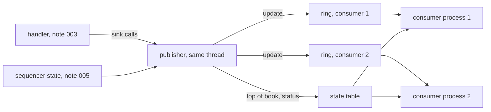

# 008 — Publication

**Status:** Agreed · **Updated:** 2026-10-27

## Proposal

Component 9 of note 001, the state publisher: other programs (strategies, displays, analytics) get
a consistent view of the handler's state, and with every piece of it, whether it is current. Note
001 places it on `lockfree-ipc`'s rings and asks for each update's sequence number and
reliability state; its S3 asks that whatever is published during a gap is marked unreliable, its
S4 that publishing makes no allocation or system call, and its S7 that live and recorded input
give the same published updates.

It publishes what the handler already reports to its sink (note 003): each book change, each
trade counted and broken, each status field set, the imbalance, the market-wide events; and the
feed's state from the sequencer (note 005). It does not decide what consumers do with it, keep
history for them, or serve late joiners anything but the current state.

## Design

**Decisions** (each with what is proposed):

- **D1. Where it runs.** *Proposed:* on the handler's thread, as the handler's sink: every call
  writes its update straight away (note 001's principle: one owner of the state; no thread more).
  *Alternative, not proposed:* a publishing thread behind another ring, which adds a hop to every
  update to save the handler a few stores.
- **D2. What an update is.** *Proposed:* one 64-byte record (a cache line): its kind (level,
  trade, trade broken, status, imbalance, market event, feed state, instrument reset), the
  reliability (D4), the Stock Locate, the sequence number of the ITCH message that caused it and
  its timestamp; for a level, the side, price, shares and orders after the change, and the
  instrument's best bid and best ask after it (price and shares each); for the others, their
  fields as decoded. A message that changes two levels (a replace) gives two updates with the same
  sequence number, the second marked last of its message.
- **D3. How consumers get updates.** *Proposed:* each consumer its own SPSC ring in its own
  named shared-memory segment (`lockfree-ipc`'s `shm_spsc`, its note 008: layout checks, stale
  recovery, liveness), up to a fixed number of consumers (default 8), each ring 65,536 updates
  (4 MB). The publisher never waits: a ring that is full marks its consumer **overrun**; it gets
  nothing more until it has read its ring empty and asked to rejoin, then a reset (D5). One slow
  consumer costs only itself. *Alternatives:* (b) one ring that every consumer reads, overwritten
  by the publisher, each reader detecting it was lapped by the slot's sequence number: one write
  per update whatever the number of consumers, but `lockfree-ipc` has no such ring, so it would be
  a new component there (its own note); (c) the state table alone (D6), with no update stream:
  consumers would see only the latest state, not every change.
- **D4. Reliability on every update.** *Proposed:* one byte, from two sources: the feed (the
  sequencer's state: live, gapped, stale, lost, ended; note 005) and the instrument (its book
  marked unreliable after a bad event, note 002's D5, or its status not seen since a snapshot,
  note 003's D5). An update is **current** only when the feed is live and the instrument is
  sound. While the feed is gapped the sequencer delivers nothing, so updates published while a
  backlog is delivered after the gap are marked **catching up** until the sequencer is live
  again. Every change of the feed's state is also published as an update of its own.
- **D5. After a snapshot.** *Proposed:* when a snapshot (note 006) rebuilds the books, each
  instrument gets a reset update, then its book as level updates, best first (as the spin
  carries it), marked catching up; a consumer that keeps books rebuilds from them. The same reset
  and replay serves a consumer rejoining after an overrun (D3), for every instrument.
- **D6. The state table.** *Proposed:* a second shared-memory segment, one entry per Stock
  Locate: best bid and ask (price, shares, orders), the last trade, the trading state and the
  reliability, each entry under its own sequence counter (a seqlock: the publisher makes it odd,
  writes, makes it even; a reader retries if it saw it odd or changed), on its own cache lines.
  For consumers that want only the latest state (displays), and for a consumer joining or
  rejoining to start from.
- **D7. The consumer side.** *Proposed:* a header for consumers (attach to the table and to a
  ring, read updates, see an overrun, rejoin, read an entry consistently), and a small example
  consumer program that keeps books from the updates and compares them with the table.
- **D8. Measurement.** *Proposed:* the publisher's own cost per update on the handler thread
  (with 0, 1, 2 and 4 consumers attached, and the table), as percentiles; the time from an
  update's write to a consumer reading it, across processes on the measured node; the whole day's
  throughput with publication on. The full path from the packet to the consumer is note 010's.

## Spec

- S1. Over the sample day, a consumer applying the updates in its ring keeps books equal, every
  level and queue length, to the handler's, and sees every trade and status change once, in
  order of sequence number; checked in another process.
- S2. With losses forced (note 005's lossy link) and a snapshot recovery (note 006), every update
  published while the feed is not live, or for an unsound instrument, is marked not current;
  every change of the feed's state is published; after a snapshot every instrument is reset and
  replayed, and the consumer's books equal the handler's again.
- S3. A consumer that stops reading never delays the publisher or another consumer: its ring
  fills, it is marked overrun, and after rejoining it is reset and its books equal the handler's.
- S4. A state table entry is never read torn: under a writer and readers on other cores, every
  entry read is one the publisher wrote (checked under TSan and on arm64 in CI).
- S5. Publishing makes no allocation and no system call (checked in the compiled code).
- S6. The publisher's cost per update (by number of consumers) and the write-to-read time across
  processes are published as ranges over at least three runs, via `run.py report`.

## Tasks

- [ ] The update record (D2) and the reliability byte (D4); the publisher as a sink (D1)
- [ ] The consumers' rings (D3) and the state table (D6); overrun and rejoin
- [ ] Resets after a snapshot (D5); the consumer header and example (D7)
- [ ] Tests (S1–S4); the compiled-code check (S5)
- [ ] The benchmark and the report (S6)

## Review

| Date | Stage | Finding |
|---|---|---|
| 2026-10-27 | Draft | Written for review. Checked in `lockfree-ipc` today: `shm_spsc` puts one SPSC ring in one named segment (layout and type checks, stale recovery, liveness, its note 008); its rings and its MPMC queue each hand an item to one reader, so a ring read by many (D3's alternative b) does not exist there. The handler's sink calls (note 003) are the publisher's inputs as they stand |
| 2026-10-27 | Agreed | Approved by Shep, every decision as proposed (option A each): D1 on the handler's thread as its sink; D2 one 64-byte update; D3 a ring per consumer in its own segment, overrun and rejoin, the publisher never waiting; D4 a reliability byte on every update, current only when the feed is live and the instrument sound, catching up after a gap, feed-state changes published; D5 reset and replay after a snapshot or a rejoin; D6 a seqlocked state table per instrument; D7 a consumer header and an example consumer; D8 the publisher's cost by number of consumers and the write-to-read time across processes |
