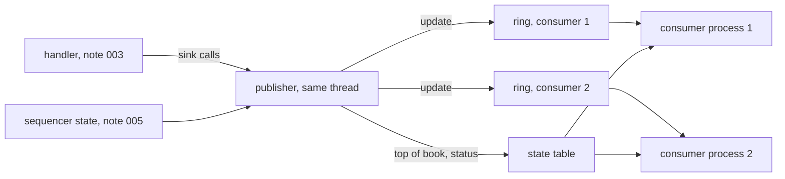

# 008 — Publication

**Status:** Measured (D5 amended by note 011) · **Updated:** 2026-10-29

## Proposal

Component 9 of note 001, the state publisher: other programs (strategies, displays, analytics) get
a consistent view of the handler's state, and with every piece of it, whether it is current. Note
001 places it on `lockfree-ipc`'s rings and asks for each update's sequence number and
reliability state; its S3 asks that whatever is published during a gap is marked unreliable, its
S4 that publishing makes no allocation or system call, and its S7 that live and recorded input
give the same published updates.

It publishes what the handler already reports to its sink (note 003): each book change, each
trade counted and broken, each status field set, the imbalance, the market-wide events; and the
feed's state from the sequencer (note 005). It does not decide what consumers do with it, keep
history for them, or serve late joiners anything but the current state.

## Design

**Decisions** (each with what is proposed):

- **D1. Where it runs.** *Proposed:* on the handler's thread, as the handler's sink: every call
  writes its update straight away (note 001's principle: one owner of the state; no thread more).
  *Alternative, not proposed:* a publishing thread behind another ring, which adds a hop to every
  update to save the handler a few stores.
- **D2. What an update is.** *Proposed:* one 64-byte record (a cache line): its kind (level,
  trade, trade broken, status, imbalance, market event, feed state, instrument reset), the
  reliability (D4), the Stock Locate, the sequence number of the ITCH message that caused it and
  its timestamp; for a level, the side, price, shares and orders after the change, and the
  instrument's best bid and best ask after it (price and shares each); for the others, their
  fields as decoded. A message that changes two levels (a replace) gives two updates with the same
  sequence number, the second marked last of its message.
- **D3. How consumers get updates.** *Proposed:* each consumer its own SPSC ring in its own
  named shared-memory segment (`lockfree-ipc`'s `shm_spsc`, its note 008: layout checks, stale
  recovery, liveness), up to a fixed number of consumers (default 8), each ring 65,536 updates
  (4 MB). The publisher never waits: a ring that is full marks its consumer **overrun**; it gets
  nothing more until it has read its ring empty and asked to rejoin, then a reset (D5). One slow
  consumer costs only itself. *Alternatives:* (b) one ring that every consumer reads, overwritten
  by the publisher, each reader detecting it was lapped by the slot's sequence number: one write
  per update whatever the number of consumers, but `lockfree-ipc` has no such ring, so it would be
  a new component there (its own note); (c) the state table alone (D6), with no update stream:
  consumers would see only the latest state, not every change.
- **D4. Reliability on every update.** *Proposed:* one byte, from two sources: the feed (the
  sequencer's state: live, gapped, stale, lost, ended; note 005) and the instrument (its book
  marked unreliable after a bad event, note 002's D5, or its status not seen since a snapshot,
  note 003's D5). An update is **current** only when the feed is live and the instrument is
  sound. While the feed is gapped the sequencer delivers nothing, so updates published while a
  backlog is delivered after the gap are marked **catching up** until the sequencer is live
  again. Every change of the feed's state is also published as an update of its own.
- **D5. After a snapshot.** *Proposed:* when a snapshot (note 006) rebuilds the books, each
  instrument gets a reset update, then its book as level updates, best first (as the spin
  carries it), marked catching up; a consumer that keeps books rebuilds from them. The same reset
  and replay serves a consumer rejoining after an overrun (D3), for every instrument.
- **D6. The state table.** *Proposed:* a second shared-memory segment, one entry per Stock
  Locate: best bid and ask (price, shares, orders), the last trade, the trading state and the
  reliability, each entry under its own sequence counter (a seqlock: the publisher makes it odd,
  writes, makes it even; a reader retries if it saw it odd or changed), on its own cache lines.
  For consumers that want only the latest state (displays), and for a consumer joining or
  rejoining to start from.
- **D7. The consumer side.** *Proposed:* a header for consumers (attach to the table and to a
  ring, read updates, see an overrun, rejoin, read an entry consistently), and a small example
  consumer program that keeps books from the updates and compares them with the table.
- **D8. Measurement.** *Proposed:* the publisher's own cost per update on the handler thread
  (with 0, 1, 2 and 4 consumers attached, and the table), as percentiles; the time from an
  update's write to a consumer reading it, across processes on the measured node; the whole day's
  throughput with publication on. The full path from the packet to the consumer is note 010's.

## Spec

- S1. Over the sample day, a consumer applying the updates in its ring keeps books equal, every
  level and queue length, to the handler's, and sees every trade and status change once, in
  order of sequence number; checked in another process.
- S2. With losses forced (note 005's lossy link) and a snapshot recovery (note 006), every update
  published while the feed is not live, or for an unsound instrument, is marked not current;
  every change of the feed's state is published; after a snapshot every instrument is reset and
  replayed, and the consumer's books equal the handler's again.
- S3. A consumer that stops reading never delays the publisher or another consumer: its ring
  fills, it is marked overrun, and after rejoining it is reset and its books equal the handler's.
- S4. A state table entry is never read torn: under a writer and readers on other cores, every
  entry read is one the publisher wrote (checked under TSan and on arm64 in CI).
- S5. Publishing makes no allocation and no system call (checked in the compiled code).
- S6. The publisher's cost per update (by number of consumers) and the write-to-read time across
  processes are published as ranges over at least three runs, via `run.py report`.

## Tasks

- [x] The update record (D2) and the reliability byte (D4); the publisher as a sink (D1)
- [x] The consumers' rings (D3) and the state table (D6); overrun and rejoin
- [x] Resets after a snapshot (D5); the consumer header and example (D7)
- [x] Tests (S1–S4); the compiled-code check (S5)
- [x] The benchmark and the report (S6)

## Review

| Date | Stage | Finding |
|---|---|---|
| 2026-10-27 | Draft | Written for review. Checked in `lockfree-ipc` today: `shm_spsc` puts one SPSC ring in one named segment (layout and type checks, stale recovery, liveness, its note 008); its rings and its MPMC queue each hand an item to one reader, so a ring read by many (D3's alternative b) does not exist there. The handler's sink calls (note 003) are the publisher's inputs as they stand |
| 2026-10-27 | Agreed | Approved by Shep, every decision as proposed (option A each): D1 on the handler's thread as its sink; D2 one 64-byte update; D3 a ring per consumer in its own segment, overrun and rejoin, the publisher never waiting; D4 a reliability byte on every update, current only when the feed is live and the instrument sound, catching up after a gap, feed-state changes published; D5 reset and replay after a snapshot or a rejoin; D6 a seqlocked state table per instrument; D7 a consumer header and an example consumer; D8 the publisher's cost by number of consumers and the write-to-read time across processes |
| 2026-10-27 | Agreed (building) | **Built.** `publication.hpp` (the 64-byte `update`, trivially copyable; the reliability byte: the feed's state in three bits, `book_unsound` and `status_unrestored` flags; the state table's segment with each consumer's slot), `publisher.hpp` (the sink; `published<Book>`, the handler with its publisher, which `feed_one` now gives each message's sequence number, the sequencer's changes of state and a `tick`), `consumer.hpp` (attach, poll, overrun, rejoin, a never-torn table read, and `pub::books`, a consumer's books from the updates), `examples/publish_consumer.cpp`. Details settled in building, within the decisions: a message's updates after its first carry a `continues` flag (D2 said the second of a replace marked last: the same information, and it covers an execution with price, a level and a trade); an event refused (note 002's D5) changes an instrument's reliability with no level changed, so it gets an `instrument` update; a replay starts with one reset for all instruments, then each instrument's levels, an instrument sent only when the consumer's ring has room for all of it (from `tick`, a budget a call), live level updates of instruments not yet replayed held back for it; while a snapshot is applied (its spin replayed through the handler, note 006) the publisher is muted, the rings untouched, then `restored()` replays to every consumer; publication runs on D4's one thread (note 007's default): the two-thread ring carries no sequence numbers. The seqlock uses release stores and acquire loads of each word, not standalone fences, which ThreadSanitizer does not model (H. Boehm, 2012); on x86 both are plain moves. `publisher::behind` and `slot` let a test or benchmark pace itself; the publisher never waits. **Tests** (`publish_test`, CI): S1 in small, a consumer in another process; S2 a gap (547 updates of its backlog marked catching up) and a loss rebuilt from a snapshot; S3 overrun and rejoin beside a consumer that keeps up; S4 the seqlock, 2 million writes and two readers, none torn. Mutants: dropping one instrument in seven's level updates fails S1–S3; a writer without the odd mark fails S4. Clean under ASan/UBSan and TSan. S5 (`check_hot_path`): a message through the handler and publisher, and a change of the feed's state, call only memory functions (`memset` now allowed: an update is cleared before it is filled); `tick` also `kill` and `errno` (its once-a-second liveness check); the handler's status read through a pointer to its status table, not a function pointer, so the check can follow it. **The day** (`publish_day_test`, label `data`): all 423,285,709 messages to a consumer in another process: its books equal the handler's; 453,409,163 level updates, 10,331,971 trades, 234,798 status changes, 4,025,192 imbalances, 7 market events, 8,916 directory entries, each once, in order; no overrun; the state table agreeing. **The benchmark** (`publish_bench`) and its report section built; a trial outside bench mode (not published): the handler alone 132 ns p50 a message, the publisher's own cost 76 ns with the table only, 98 with one consumer, 204 with two, 301 with four; write to read paced at a million messages a second 280 ns p50 for the first consumer, rising with each consumer's place in the push order (494 for the fourth of four) |
| 2026-10-27 | Built (runs published) | **Six bench-mode runs** (`08acac7`, clean; `results/publish-dev-lnx01-20261027T145206Z.json` and five more to `…152502Z`; the first a check run, read before the others, its case list unchanged). No consumer overrun in any. p50 a message: no publisher 132–178 ns, table only 208 in every run, one consumer 229–231, two 293–354, four 425–499; paced write to read, the first consumer, 273–298 ns, each further consumer later by its place in the push order (the fourth of four 475–532). Published as absolute figures: the publisher's cost as a difference from no publisher would carry the baseline's spread (132, 132, 136, 138, 149, 178 over the six runs, the same binary and data), while the cases with the publisher stayed within a few ns. **Open:** that spread in the handler alone (the cases with the publisher do not show it); the two-consumer case's 293–354; the table's own 72 ns or so at the usual baseline (a guess: cache misses on the instrument's status, the publisher's mirror and the table entry, at random instruments; not counted); the second consumer costing several times the first, and p99.9 rising from ~0.95 µs to ~4.2 µs once any consumer is attached (cache lines moving between cores, a guess, not shown). Against the Spec: S1 (`publish_test`, `publish_day_test`), S2–S4 (`publish_test`), S5 (`check_hot_path`), S6 (these runs). For Shep's review for Measured |
| 2026-10-27 | Measured | Reviewed and approved by Shep against the Spec: S1–S6 met as recorded above (S5 with `tick`'s liveness check stated); open: the handler-alone spread, the two-consumer spread, the table's cost, the second consumer's cost and the p99.9 with any consumer attached |
| 2026-10-27 | Measured (finding, from note 009) | **A consumer on the other socket slows the publisher, and with it the feed.** Found by note 009's day through the programs, then bisected (60 million messages at 50k packets a second, the program on CPU 2): with the example consumer on CPU 3 (the publisher's node) no kernel drops; on CPU 30 (the other) 1,246,370 kernel drops of 1.34 million datagrams and 2.2 million re-requests; unpinned, 907,216. The publisher never waits, as designed (S3 holds: a consumer that stops reading costs nothing), but each push writes lines a remote reader keeps pulling across the sockets, which slows the thread that also receives. This note's benchmark pins its consumers on the publisher's node, so did not show it. **Open, for Shep:** a consumer on the other node is not refused or warned of; remedies are a decision (state the limit and have consumers report their node; or a relay per socket; or publishing in batches) |
| 2026-10-27 | Measured (amendment) | **The cross-socket finding, decided by Shep (option A): the limit stated and watched.** The publisher writes its NUMA node in the state table's header (layout version 2), each consumer reports its node in its slot at attach (`consumer::report_node`, again after moving), the publisher's once-a-second sweep counts consumers on another node (`publisher::remote_consumers`), and note 009's monitoring shows the count and calls the feed unhealthy while it is not zero; `consumer::pin_to_publisher_node` restricts a consumer's thread to that node's CPUs, and the example consumer does so. `publish_test`: a consumer pinned there is not counted; one reporting another node is, and the monitoring flags it (n/a where no topology is visible). A relay per socket (B) not built |
| 2026-10-28 | Measured (amendment, from note 010) | **The published figures were inflated by the benchmark: copy-on-write after `fork()`.** `publish_bench` forked its consumers after building the producer's book and publisher, so the producer's first write to each of their pages afterwards was a copy-on-write fault (~3 µs), and each further fork shared the pages again (found and measured in note 010's Review: a participant position costs 135 ns without a consumer, 2,994 with one forked after, 147 with one forked first). This likely explains the open items above: the second consumer costing several times the first, the spreads with consumers, and perhaps part of the table's cost. Amended: consumers forked first. The `publish` set to be re-measured at the fixed commit (agreed with Shep, option A); the figures above are superseded once it is |
| 2026-10-28 | Measured (re-measured) | **The `publish` set re-measured with consumers forked first** (`1f39862`, clean; `results/publish-dev-lnx01-20261028T162547Z.json`, `…162758Z`, `…163012Z`; a check run before them set aside: the sender, pinned to CPU 4, ran beside its consumers on CPUs 3–6). No overrun. p50 a message: no publisher 197 ns in every run, table only 269–270, one consumer 229–291, two 350–364, four 453–489; paced write to read, the first consumer, 281–316 ns (one consumer). The baseline moved between builds of the same code (132–178 ns at `08acac7`, 197 here, steady in each), while the table's cost over it stayed ~72 ns in both: code placement suspected, not shown (the gateway found two branch-predictor states in its decoder). With copy-on-write gone the consumers still add: the second ~85–135 ns over the first at p50, the fourth ~200 over the table; the earlier set's open items (the second consumer costing several times the first, the spreads) are thus partly explained, not wholly. Published, replacing the earlier set |
| 2026-10-28 | Measured | The re-measured set accepted by Shep; open: the baseline's move between builds, the consumers' remaining cost |
| 2026-10-29 | Measured (amendment, from note 011) | **D5 amended, found building note 011's recovery.** While a snapshot was applied the publisher was muted to the rings but the state table followed the spin. So a spin that failed part way left its partial state in the table (note 011's S2 forbids it), and after a successful one an instrument with orders in the old book and none in the spin kept its old entry, marked current once the feed was live (the old tests did not see it: every instrument there traded again soon after). Now `mute` leaves the table alone too (the sink calls that write it return at once while muted: one predictable branch each on the publishing path), and `restored()` rebuilds every entry from the rebuilt book (best bid and ask; no last trade, GLIMPSE carrying none; the trading state as restored) before replaying every consumer. Checked by note 011's `recovery_test` (an entry emptied by the rebuild; the table unchanged across every failed spin; both mutants caught). The `publish` set is not re-measured for the branch |
