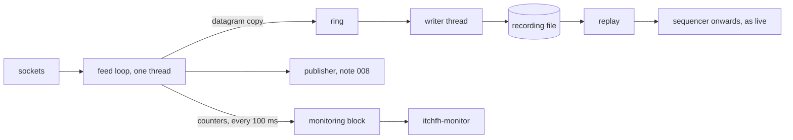

# 009 — Recording and monitoring

**Status:** Agreed · **Updated:** 2026-10-27

## Proposal

Components 11 and 12 of note 001, kept minimal as it agreed. The **data recorder** saves what was
received, for investigation, testing and replay, without slowing the main path, and says whether
the capture is complete. **Configuration and monitoring** define the feed, the limits and the
CPUs in one place, and report the handler's health: connection, gaps, delays and failures.

Earlier notes fix part of it. Note 007's D5: a recording is the datagrams as they were received,
replayed into the sequencer as if from the socket, so everything from the sequencer on is the live
code. Note 001's S7: a run received over multicast and recorded, replayed from the recording,
gives the same books and the same published updates.

The handler has so far been assembled only inside tests and benchmarks. This note also adds the
program that runs it: receiving (note 007), sequencing (005), decoding and handling (004, 003),
publishing (008), recording and monitoring, from one configuration file. It does not add
alerting, dashboards or a metrics service: health is a block of shared memory and a tool that
reads it.

## Design

**Decisions** (each with what is proposed):

- **D1. What is recorded.** *Proposed:* every datagram as the receive thread read it, from both
  sockets (the group and the request socket, note 007's D1), in the order read, each with its
  length, the socket, and the kernel's receive stamp (note 007's D8). *Alternative:* the decoded
  messages, which lose what the network did (loss, order, answers) and so cannot test recovery.
- **D2. Not slowing the main path.** *Proposed:* the receive thread copies each datagram into
  an SPSC ring (`lockfree-ipc`, slots of 1,600 bytes, 16,384 of them: about half a second at the
  day's busiest millisecond); a writer thread on a housekeeping CPU empties it to the file. The
  receive thread never waits: a full ring means the datagram is not recorded, counted, and the
  recording marked incomplete from there. *Alternative:* writing from the receive thread, which
  puts every system call and every disk stall on the path.
- **D3. Writing the file.** *Proposed:* large sequential writes (4 MB buffers), with
  `sync_file_range` started on each written buffer so dirty pages never build up to the kernel's
  30-second writeback (the gateway's note 004: ext4 writeback stalled its engine 0.3–2.5 ms every
  5 s once a file had been dirty that long), and `fdatasync` at the end. The disk here: ext4 on the
  P440ar's one SAS disk, 827 GB free; the sample day is 12.5 GB of datagrams, 22 MB a second in
  its busiest second. *Alternative, measured only if the first disturbs the receive thread:*
  `O_DIRECT`.
- **D4. Complete or not.** *Proposed:* a header (magic, version, session, the configuration's
  digest, start time) and a trailer (datagrams recorded, datagrams not recorded, the kernel's
  drop counts at the end, end time). A recording is complete when its trailer is there, nothing
  was left unrecorded, and its replay ends with no gap left open. A recording cut short (the
  process killed) has no trailer: it is read up to its last whole record and reported incomplete.
- **D5. Replay.** *Proposed:* a recording read datagram by datagram into the sequencer, as note
  007's D5 has it, then decoder, handler and publisher, at full speed or at the recorded pace (the
  kernel stamps); the program's `--replay <file>` in place of the sockets.
- **D6. Monitoring.** *Proposed:* every component's counters (receive, sequencer, decoder,
  handler, book, publisher, recorder) and a health state for each (feed: its sequencer state,
  seconds since the last datagram; recorder: backlog, unrecorded; publisher: consumers and
  overruns) copied by the feed loop's tick every 100 ms into a monitoring block in shared memory,
  under a seqlock (note 008's), with no allocation or system call. A tool, `itchfh-monitor`, prints
  it once or every second, and exits non-zero if anything is unhealthy, for scripts.
  *Alternative:* logs or a metrics endpoint, more than "kept minimal" calls for.
- **D7. Configuration and the program.** *Proposed:* one file of `key = value` lines (the
  group, interface, ports and re-request server; receive buffer and busy polling; CPUs; book,
  hold and ring sizes; the publisher's name; the recording's directory), every key validated at
  start, unknown keys refused; its digest kept in the recording's header. The program `itchfh`
  runs one feed from it until the end of session or a signal. *Alternative:* command-line flags
  only, which a recording could not cite.
- **D8. Measurement.** *Proposed:* the recorder's cost on the receive thread a datagram (the
  copy into the ring); kernel to handled (note 007's measure) with recording on and off, to show
  it does not disturb the path; the writer's sustained rate; at the paces of note 007's benchmark.
  End to end, from the packet to the published update, is note 010's.

## Spec

- S1. The sample day received over loopback at 100k packets a second, with packets dropped by
  the sender, recorded, then replayed from the file, gives the same books and the same published
  updates (a digest of the update stream) as the live run (note 001's S7), and the recording is
  reported complete.
- S2. The receive path never waits on the recorder: with the writer held back on purpose, the
  feed carries on, the datagrams not recorded are counted, and the recording is reported
  incomplete from the first of them.
- S3. A recording cut short (the program killed) is read up to its last whole record and reported
  incomplete; a corrupted record is detected, not replayed.
- S4. The monitoring block is never read torn; at the end its counters equal the components'
  own; each health state changes as forced (silence, a loss, a consumer overrun, the recorder held
  back).
- S5. The recorder's path on the receive thread and the monitoring refresh make no allocation or
  system call (checked in the compiled code).
- S6. The recorder's cost a datagram, kernel to handled with recording on and off, and the
  writer's sustained rate are published as ranges over at least three runs, via `run.py report`.

## Tasks

- [x] The recording format, the ring and writer (D1–D4)
- [x] Replay from a file (D5)
- [x] The monitoring block and `itchfh-monitor` (D6)
- [x] The configuration and the program `itchfh` (D7)
- [x] Tests (S1–S4); the compiled-code check (S5)
- [ ] The benchmark and the report (S6)

## Review

| Date | Stage | Finding |
|---|---|---|
| 2026-10-27 | Draft | Written for review. On this machine today: `/` is ext4 on `sda`, the P440ar's logical volume (one SAS disk, its cache battery-backed: the gateway's note 004), 827 GB free; `vm.dirty_expire_centisecs` 3000 (30 s), `dirty_background_ratio` 10, `dirty_ratio` 20. The sample day's datagrams are 12.5 GB (note 007's recordings: 9.39 million), at 0.22 MB a second on average and about 22 MB a second in its busiest second (16,102 packets) |
| 2026-10-27 | Agreed | Approved by Shep, every decision as proposed (option A each), the program of D7 included: D1 datagrams as read, both sockets, with kernel stamps; D2 a ring to a writer thread, the receive thread never waiting; D3 4 MB writes with `sync_file_range`, `fdatasync` at the end; D4 header and trailer, complete only if nothing unrecorded and the replay leaves no gap; D5 replay into the sequencer onwards; D6 a seqlocked monitoring block every 100 ms and `itchfh-monitor`; D7 one validated `key = value` file and the program `itchfh`; D8 the recorder's cost, kernel to handled with recording on and off, the writer's rate |
| 2026-10-27 | Agreed (building) | **Built.** `recording.hpp` (the file: a 64-byte header, records of a 24-byte header with a CRC-32 over it and the bytes, a trailer; the recorder: a datagram copied into a scratch slot then lockfree-ipc's ring, which copies the 1,600-byte slot again, having no in-place push; the writer thread: 4 MB buffers, `sync_file_range` to start each buffer's writeback and wait for the one before, so at most two are dirty, a flush every 100 ms when idle, `fdatasync` at the end; the reader: truncated and corrupt told apart), `replay.hpp` (the sequencer's clock the records' kernel stamps; stops on the program's signal), `monitoring.hpp` (25 counters and the feed's state under the seqlock; health: stale, lost, silent 2 s, a datagram unrecorded or a consumer overrun unhealthy, gapped and kernel drops alone not), `config.hpp`, `apps/itchfh.cpp` (`--replay`, `--paced`, and `--wait-consumers N` so a consumer can see a replay from its start), `apps/itchfh_monitor.cpp`; `feed_one` gains a recorder, told of every datagram from either socket, and the time of the last one. Settled in building: the publisher writes Stock Directory, IPO, LULD and DLCR bodies field by field (their structs' padding had made live and replayed updates differ in bytes the decoder never writes; note 008's D2). **Tests** (`record_test`, CI): S3 the format (50,000 datagrams back as written; cut at five places, each read to its last whole record and reported truncated; a changed byte reported corrupt); S2 the writer held back (16,384 kept, 3,616 unrecorded, counted, the next record carrying the count, the trailer and the health saying so); S1 in small over loopback (recorded, replayed: the same books, the same updates byte for byte, complete; the monitoring block's counters the components'); S4 the block never torn (8 million writes against 20,000 reads on another thread) and health as forced; the configuration's checks. Mutants: a replay ignoring the request socket's records fails S1; a block without the odd mark fails S4. Clean under ASan/UBSan and TSan. S5 (`check_hot_path`): a feed pass with the recorder, `record()` (one `memcpy`), the monitoring refresh. **The day through the programs** (`record_day_test`, label `data`): `feed_sender` over loopback multicast at 50k packets a second, 1% dropped; `itchfh` received, published, recorded all 9,513,184 datagrams (12.75 GB, 64,756 kernel drops recovered), none unrecorded, healthy; `itchfh --replay --paced --wait-consumers 1`: complete; both consumers' books equal a book fed the day directly, the 468,192,699 updates the same byte for byte (note 001's S7). **Found on the way:** (1) at 100k packets a second publishing the program's thread cannot keep up (note 007's ~8.5 µs a datagram, plus note 008's ~93 ns a message, ~43 a datagram: ~12.5 µs, a ceiling near 80k); the feed was lost and, with no snapshot path wired into the program, waited (monitoring said lost); the test now runs at 50k, and stops the program and fails with its counters if the session does not end; (2) a consumer on the other socket slows every push (note 008, Review); (3) `pub::books`, ordered maps, cannot follow the live day at 50k (overrun after 9.9 million updates); the test's consumer keeps a hash table, sorted once for the same digest. The recorder itself costs little: `record()` 47 ns p50 (169 at p99) in a trial outside bench mode, and the disk sustained 283 MB/s flat out, so at 100k packets a second (~140 MB/s) it would keep up; the Draft's 22 MB/s is the day at its own pace, not our six times faster |
| 2026-10-27 | Agreed (building) | **Found by CI under TSan, fixed: a replay must not give up on re-requests.** The replay ran the sequencer's live retries (5, 1 ms apart) on the records' kernel stamps; nobody answers in a replay, the answer being later in the file, and the stamps are not the times the live sequencer saw, so on CI's slow runner a replay went lost where the live run had not (feed changes 27 against 49). The replay now never gives up on a re-request; a gap still open at the end makes the recording incomplete (D4), so the replay depends only on what was recorded |
| 2026-10-27 | Built (check run) | **A bench-mode check run** (`d60eec1`, clean; not published; kept outside the repo). The feed, every case whole, nothing unrecorded: recording costs **~770 ns a datagram** (cost p50 8,213 → 8,985 ns at 50k, 8,198 → 8,926 at 100k, ~9%), kernel to handled p50 2.48 → 2.85 µs at 50k (p99.9 3.35 → 3.97 µs), and at 100k, one thread then 89% busy, p99 70 → 830 µs. **A flaw in the benchmark:** flat out, 98.7% of `record()` calls found the ring full, so its single figure (43 ns p50) was mostly the refusal; it now times the calls that recorded and those refused apart. The disk took 286 MB/s. The 770 ns is more than a copy of a datagram should cost; a guess, not shown: the two copies (into the scratch slot, then into a ring slot of 25 cache lines, cycling through 26 MB that the writer reads on another core) miss in the cache. Open, for Shep |
| 2026-10-27 | Built (decision) | **Agreed with Shep (option A):** the recorder's ~770 ns a datagram published as measured, the cause (the guess above) left open; copying each datagram once, straight into its ring slot, would need lockfree-ipc's ring to push in place or a ring of the recorder's own (not done). Monitoring gains `consumers_remote` and its health bit (note 008's amendment; the block's version 2). Next: the fixed benchmark's check run, two more, publish |
